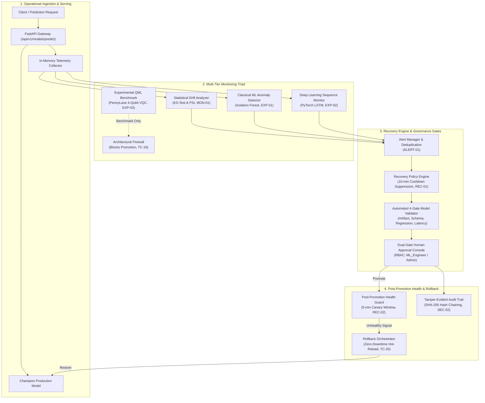

# Self-Monitoring MLOps System

An intelligent, self-monitoring Machine Learning Operations (MLOps) framework for production ML services, featuring multi-metric statistical drift detection, unsupervised anomaly scoring, sequential temporal monitoring, experimental quantum ML benchmarking with architectural firewalling, and closed-loop automated recovery with post-promotion health guards and rollback orchestration.

---

## 1. Executive Overview & System Architecture

Modern production machine learning systems suffer from silent performance degradation caused by data drift, concept drift, and temporal shifts. The **Self-Monitoring MLOps System** solves this through a self-healing architecture:



---

## 2. Technology Stack

| Layer | Technologies & Libraries | Purpose |
| :--- | :--- | :--- |
| **API & Web Framework** | FastAPI `0.115.x`, Uvicorn `0.30.x`, Starlette, Pydantic v2 | High-performance async REST API and static dashboard serving |
| **Tabular Baseline ML** | Scikit-learn `1.5.x`, NumPy `1.26.x`, Pandas `2.2.x` | Production RandomForest credit risk classifier and feature pipelines |
| **Statistical Drift Engine** | SciPy `1.13.x` (Two-sample KS-Test, Chi-Square), NumPy (PSI) | Continuous numerical and categorical distribution drift evaluation |
| **Unsupervised Anomaly** | Scikit-learn `IsolationForest` | Real-time multivariate outlier scoring and density isolation (EXP-01) |
| **Sequential Temporal DL** | PyTorch `2.x` (`LSTMAutoencoder`), CPU execution | Unsupervised sequence anomaly and temporal concept shift detection (EXP-02) |
| **Quantum ML Benchmark** | PennyLane `0.40.x` (`default.qubit` statevector simulator) | 4-qubit Variational Quantum Circuit benchmark with architectural firewall (EXP-03) |
| **Model Registry & Tracking** | MLflow `2.15.x` (SQLite backend, local artifact store) | Lifecycle experiment tracking, run metadata, and champion aliasing |
| **Data Versioning** | DVC (Data Version Control) `3.50.x` | Golden reference datasets and synthetic drift fixture versioning |
| **Security & Auditing** | PyJWT, Passlib / CryptContext, SQLite with SHA-256 chaining | JWT Bearer tokens, three-tier RBAC, and tamper-evident audit logging |
| **Containerization & CI** | Docker multi-stage build, Docker Compose, GitHub Actions | Isolated packaging, unprivileged user execution, and automated CI/CD |
| **Testing & Quality** | Pytest `9.x`, Coverage.py `7.x`, Flake8 `7.x`, Bandit `1.8.x` | 182-test suite, 95.15% statement coverage, 87.45% strict branch coverage |

---

## 3. Quickstart & Installation Guide

### 3.1 Prerequisites
- **Python:** Python 3.10, 3.11, or 3.13 (Python 3.11 recommended for container parity).
- **Git:** Version 2.30+.
- **Virtual Environment Tool:** `venv` or `conda`.
- **Optional:** Docker and Docker Compose (v20.10+).

### 3.2 Environment Setup
```powershell
# 1. Clone the repository
git clone https://github.com/akashgkuradagi/self-monitoring-mlops-system.git
cd self-monitoring-mlops-system

# 2. Create and activate a Python virtual environment
python -m venv .venv

# On Windows PowerShell:
.venv\Scripts\activate

# On Linux / macOS bash:
# source .venv/bin/activate

# 3. Upgrade pip and install all project dependencies
pip install --upgrade pip
pip install -r requirements.txt
pip install flake8 bandit coverage
```

### 3.3 Dataset Preparation & Offline DVC Setup
The repository includes a deterministic credit risk dataset generator and synthetic drift fixtures for offline execution without external cloud storage credentials:
```powershell
# Generate golden baseline (train/val), reference, and 3 synthetic drift fixtures
python scripts/prepare_datasets.py
```

### 3.4 Model Training & Experiment Benchmarking
Generate the baseline model weights and run the monitoring experiment workers:
```powershell
# 1. Train production baseline classifier (RandomForest) and record MLflow run
python scripts/train_baseline.py

# 2. Train unsupervised Isolation Forest anomaly detector (EXP-01)
python scripts/train_ml_monitor.py

# 3. Train PyTorch LSTM sequential autoencoder (EXP-02)
python scripts/train_dl_monitor.py

# 4. Execute PennyLane 4-qubit Quantum VQC benchmark (EXP-03)
python scripts/run_qml_benchmark.py
```

---

## 4. Running the Application Locally

Start the FastAPI application via Uvicorn:
```powershell
python -m uvicorn app.main:app --host 0.0.0.0 --port 8000 --reload
```

### Key Service Endpoints:
- **Interactive Web Dashboard:** [http://localhost:8000/dashboard](http://localhost:8000/dashboard)
- **Public Service Health Check:** [http://localhost:8000/health](http://localhost:8000/health)
- **Interactive Swagger OpenAPI Docs:** [http://localhost:8000/docs](http://localhost:8000/docs)
- **Operational Telemetry Summary:** [http://localhost:8000/api/v1/metrics/summary](http://localhost:8000/api/v1/metrics/summary)
- **Active Model State:** [http://localhost:8000/api/v1/models/active](http://localhost:8000/api/v1/models/active)

### Demo Dashboard Accounts:
| Role | Username | Password | Capabilities |
| :--- | :--- | :--- | :--- |
| **Viewer** | `viewer` | `viewer123` | Read-only inspection of metrics, drift reports, and audit logs |
| **ML Engineer** | `engineer` | `engineer123` | Validate candidates, approve promotions, manage alerts, trigger rollback |
| **Administrator** | `admin` | `admin123` | Full administrative access, policy configuration, SHA-256 audit verification |

---

## 5. Verification, Testing & Coverage

### 5.1 Running the Standard Test Suite
Execute the standard automated test suite across all 17 test modules:
```powershell
# Standard quiet execution (excludes long-running soak probes)
pytest -q

# Verbose execution with short tracebacks
pytest -v --tb=short
```
*Current Suite Status:* **182 passed, 1 deselected, 0 failed in ~50s**.

### 5.2 Running Code Coverage (Statement & Branch)
Generate strict branch and statement coverage reports targeting application code:
```powershell
# 1. Run full test suite with branch measurement enabled
python -m coverage run --branch -m pytest -q

# 2. View terminal coverage summary
python -m coverage report --include="app/*"

# 3. Export detailed HTML coverage report
python -m coverage html --include="app/*" -d reports/coverage_html
```
*Current Measured Metrics:*
- **Statement Coverage:** **95.15%** ($2,885 / 3,032$ statements, exceeding $\ge 80\%$ target).
- **Strict Branch Coverage:** **87.45%** ($474 / 542$ decision branches, exceeding $\ge 85\%$ target).
- **Combined Coverage:** **93.98%** ($3,359 / 3,574$ elements).

### 5.3 Running the Official TC-18 Continuous Availability Soak Test
Test Case `TC-18` validates `NFR-03` ($\ge 99.0\%$ availability across a 30-minute continuous health probe):
```powershell
# Execute the full 30-minute (1,800 seconds) soak probe:
python scripts/run_tc18_soak.py --duration 1800 --interval 5.0 --output reports/tc18_availability_soak_report.json

# Alternatively, run via pytest with soak marker:
pytest -m soak -v
```

### 5.4 Linting & Security Auditing
```powershell
# Run Flake8 PEP 8 linter (0 errors enforced)
flake8 app tests

# Run Bandit AST security scanner (0 High / Medium vulnerabilities)
bandit -r app -ll
```

---

## 6. MLflow Tracking & DVC Data Management

### 6.1 MLflow Tracking Server
Launch a local MLflow tracking server connected to the SQLite metadata repository:
```powershell
mlflow server --backend-store-uri sqlite:///data/mlflow.db --default-artifact-root ./mlflow_artifacts --port 5000
```
Open [http://localhost:5000](http://localhost:5000) to view experiments:
- `production-models`: Baseline and retrained champion candidate runs.
- `classical-ml-monitor`: Isolation Forest unsupervised anomaly detector runs.
- `dl-sequence-monitor`: PyTorch LSTM temporal autoencoder runs.
- `qml-benchmarks`: PennyLane 4-qubit VQC benchmark runs.

### 6.2 DVC Data Pipelines
```powershell
# Check data tracking status
dvc status

# Reproduce data preparation and baseline training stages
dvc repro
```

---


## Automated CI/CD Pipeline (CI-01)

The system includes an automated continuous integration pipeline implemented with **GitHub Actions** (`.github/workflows/ci.yml`).

### Workflow Triggers
- **Push**: Evaluated on every commit pushed to `main` and all `feature/**` branches.
- **Pull Request**: Evaluated automatically on PRs opened or updated against `main`.
- **Manual Dispatch**: Can be triggered on-demand via `workflow_dispatch` in the GitHub Actions console.

### Pipeline Stages & Execution Order
1. **Checkout**: Checks out the code repository (`actions/checkout@v4`).
2. **Python Environment Setup**: Configures Python 3.11 with pip package caching (`actions/setup-python@v5`).
3. **Dependency Installation**: Upgrades pip and installs project dependencies from `requirements.txt` alongside testing tools (`flake8`, `bandit`, `coverage`).
4. **Code Quality & Linting**: Runs `flake8 app tests` enforcing PEP 8 standards with line length $\le 120$ characters.
5. **Security Scanning**: Runs `bandit -r app -ll` to scan for high- and medium-severity security vulnerabilities.
6. **DVC Dataset Verification**: Verifies tabular reference baseline and synthetic drift fixtures. If `DVC_REMOTE_URL` is configured, it attempts remote synchronization; otherwise, it executes the deterministic dataset generator in offline mode.
7. **Test Suite & Coverage**: Executes the complete 80-test pytest suite using `coverage run -m pytest -v`, producing console summary and `coverage.xml`.
8. **Artifact Upload**: Uploads `coverage.xml` as a build artifact via `actions/upload-artifact@v4`.
9. **Smoke Test Probe**: Launches FastAPI via Uvicorn in the background and probes `/health` and `/api/v1/metrics/summary` to verify runtime health.

### Configurable GitHub Secrets
- `DVC_REMOTE_URL` *(Optional)*: Remote storage URI (e.g. S3, GCS, or HTTP) for DVC dataset pulling. If absent, the pipeline safely runs offline without network dependencies.
- `AWS_ACCESS_KEY_ID` / `AWS_SECRET_ACCESS_KEY` *(Optional)*: Required only when utilizing an authenticated S3 DVC remote.

## Docker Containerization & Multi-Container Docker Compose (PKG-01)

The system is packaged as an isolated, multi-container production stack using **Docker** and **Docker Compose**.

### Container Architecture & Topology
1. **`web` (FastAPI Application)**: Serves health checks, operational telemetry ingestion, model prediction, statistical drift analysis, and alert management on port `8000`. Runs as an unprivileged non-root user (`mlops`, UID 1001).
2. **`mlflow` (MLflow Tracking & Model Registry)**: Dedicated MLflow server running on port `5000` connected to SQLite metadata storage (`/data/mlflow.db`) and artifact repository (`/data/artifacts`).
3. **`mlops_data` (Persistent Volume)**: Named volume shared across services preserving audit logs, alerts, active model states, and MLflow artifacts across container restarts.
4. **`mlops_net` (Isolated Bridge Network)**: Provides secure internal container DNS routing (`http://mlflow:5000`).

### Prerequisites
- [Docker Engine](https://docs.docker.com/engine/) or [Docker Desktop](https://www.docker.com/products/docker-desktop/) (v20.10+ / Compose v2.0+).

### Build Instructions
Build the multi-stage production image:
```bash
# Standard bash / Linux / macOS
docker compose build

# Windows PowerShell
docker compose build
```

### Starting the Stack
Launch the multi-container environment in detached mode:
```bash
# Standard bash / Linux / macOS
docker compose up -d

# Windows PowerShell
docker compose up -d
```

### Accessing Endpoints
- **FastAPI Service**: [http://localhost:8000](http://localhost:8000)
- **Interactive OpenAPI Docs**: [http://localhost:8000/docs](http://localhost:8000/docs)
- **Health Check Probe**: [http://localhost:8000/health](http://localhost:8000/health)
- **Operational Metrics Summary**: [http://localhost:8000/api/v1/metrics/summary](http://localhost:8000/api/v1/metrics/summary)
- **MLflow Tracking UI**: [http://localhost:5000](http://localhost:5000)

### Verification Commands
```powershell
# PowerShell
Invoke-RestMethod -Uri "http://localhost:8000/health"
Invoke-RestMethod -Uri "http://localhost:8000/api/v1/metrics/summary"
Invoke-RestMethod -Uri "http://localhost:5000/health"

# Bash / curl
curl -f http://localhost:8000/health
curl -f http://localhost:8000/api/v1/metrics/summary
curl -f http://localhost:5000/health
```

### Inspecting Logs
```bash
# View combined logs
docker compose logs -f

# View FastAPI service logs only
docker compose logs -f web

# View MLflow server logs only
docker compose logs -f mlflow
```

### Graceful Shutdown
Stop all running containers without destroying persistent volume data:
```bash
docker compose down
```
*(To purge persistent volumes as well, pass `docker compose down -v`)*

## Classical ML Anomaly Detector — Isolation Forest (EXP-01)

The system incorporates an unsupervised classical ML anomaly detector using scikit-learn's `IsolationForest` (`app/models/ml_monitor.py`) to detect individual out-of-distribution instances and multi-feature anomalies independently of ground truth labels.

### Architecture & Pipeline
- **Unsupervised Training**: Fitted strictly on tabular baseline reference features (`train.csv`) without exposure to target labels (`loan_status`).
- **Feature Preprocessing**: Encapsulated in a scikit-learn `ColumnTransformer`:
  - `StandardScaler` applied to `NUMERICAL_FEATURES` (`person_age`, `person_income`, `person_emp_length`, `loan_amnt`, `loan_int_rate`, `loan_percent_income`, `cb_person_cred_hist_length`).
  - `OneHotEncoder(handle_unknown="ignore")` applied to `CATEGORICAL_FEATURES` (`person_home_ownership`, `person_default_on_file`).
- **Hyperparameters**:
  - `n_estimators`: `100`
  - `contamination`: `0.05`
  - `random_state`: `42`
- **Output Metrics**:
  - `is_anomaly`: Boolean indicator ($1 = \text{anomaly}, 0 = \text{normal}$).
  - `anomaly_score`: Normalized anomaly severity in $[0, 1]$ where higher values denote stronger divergence.
  - `raw_score`: Scikit-learn decision function score (negative values indicate anomalies).
  - `decision_offset`: Fitted separation threshold.

### MLflow Experiment Tracking
- Logged under dedicated experiment name: **`classical-ml-monitor`** (fulfilling SRS FR-05 & Test Plan TC-05).
- Model artifacts registered via `cloudpickle` alongside training hyperparameters, baseline anomaly ratios, and mean decision metrics.
- **Production Isolation**: Preserves `ProductionClassifier` and the `champion` model alias unchanged; experimental models never override production serving pipelines without explicit approval.

### Monitoring API Endpoint
- **Endpoint**: `POST /api/v1/monitoring/anomaly/evaluate`
- **RBAC**: Protected by `require_viewer` (accessible to `Viewer`, `ML_Engineer`, and `Administrator`).
- **Audit Logging**: Emits immutable `ANOMALY_EVALUATED` audit record linked to caller identity.
- **Input Payload**: Single inference record or batch records.
- **Response**: Batch summary statistics (total evaluated, anomaly count, anomaly ratio) and per-record anomaly predictions.

### Distinction: EXP-01 vs MON-01
- **MON-01 (Statistical Drift Engine)**: Analyzes statistical population shifts across temporal sliding windows (Kolmogorov-Smirnov test for numerical continuous features, PSI for marginal distributions). Requires multi-sample monitoring windows.
- **EXP-01 (Isolation Forest Detector)**: Analyzes individual, multivariate instance outlierness and density isolation at inference time. Operates in real time on single observations or batch submissions without waiting for a temporal window.

## Deep Learning Sequence / Temporal Shift Model — PyTorch LSTM (EXP-02)

The system incorporates an unsupervised sequential deep learning monitor using a PyTorch `LSTMAutoencoder` (`app/models/dl_monitor.py`) to detect temporal concept shifts, multi-step sequential anomalies, and abrupt changepoints across sliding observation windows (fulfilling SRS FR-06 & Test Plan TC-05).

### Architecture & Pipeline
- **Why LSTM?** Standard statistical metrics evaluate marginal distributions in aggregate, while classical models treat rows independently. The LSTM Autoencoder learns normal sequential temporal transitions across consecutive observation windows, flagging sequences where sequential correlation or joint distributions diverge.
- **Neural Architecture (`LSTMAutoencoder`)**:
  - **Encoder**: `nn.LSTM(input_size=18, hidden_size=32, batch_first=True)` followed by `nn.Linear(32, 16)` extracting a compressed latent state vector.
  - **Decoder**: `nn.Linear(16, 32)` + `torch.relu`, sequence repeater across $W=10$ steps, `nn.LSTM(hidden_size=32, hidden_size=32, batch_first=True)`, and `nn.Linear(32, 18)` reconstructing the $(B, W, D)$ sequence.
  - **Execution Device**: Configured strictly for CPU execution (`device="cpu"`) for universal portability without GPU dependencies.
- **Sequential Window Construction**:
  - Sliding windows with sequence length $W=10$ and stride $S=1$.
  - Strictly preserves chronological ordering without shuffling before sequence construction.
  - Zero future leakage: window $t$ uses only historical observations from $t - W + 1$ to $t$.
  - Zero target leakage: target label (`loan_status`) is strictly excluded from unsupervised feature sequences.
  - Zero partition leakage: training sequences are constructed exclusively from `train.csv` (3,491 sequences), and validation sequences from `val.csv` (741 sequences).

### Training, Calibration & Fixture Benchmarks
- **Loss Function**: Mean Squared Error (MSE) across sequence features.
- **Optimizer**: Adam with learning rate $\eta = 0.003$ and weight decay $10^{-5}$ over 15 epochs.
- **Decision Threshold**: Calibrated as the 95th percentile of reconstruction loss on the baseline validation set (`val.csv`), establishing a 5% baseline false positive rate ($\tau = 0.5509$).
- **Fixture Sensitivity**:
  - *Stable Fixture*: Mean Loss = $0.3711$, Shift Ratio = $0.006$ (low false positive rate).
  - *Numerical Covariate Drift*: Mean Loss = $0.4166$, Shift Ratio = $0.066$ (spikes under economic recession shifts).
  - *Abrupt Sudden Drift*: Mean Loss = $0.3975$, Shift Ratio = $0.045$ (detects post-changepoint distribution break).
  - *Step-wise Gradual Drift*: Mean Loss = $0.3819$, Shift Ratio = $0.029$ (tracks progressive degradation across batches).

### MLflow Experiment Tracking
- Logged under dedicated experiment name: **`dl-sequence-monitor`** (Run ID: `b161b5b16d254950bfc6a165251ae1ea`).
- Artifacts: PyTorch traced model, preprocessor, configuration metadata, and comprehensive evaluation scorecard.
- **Production Decoupling**: Decoupled from the production serving pipeline to ensure zero disruption to live inference latency; `ProductionClassifier` and its `champion` alias remain completely untouched.

### Monitoring API Endpoints
- **Single Window Evaluation**: `POST /api/v1/monitoring/sequence/evaluate`
- **Sliding Stream Evaluation**: `POST /api/v1/monitoring/sequence/batch`
- **RBAC**: Protected by `require_viewer` (Viewer, ML_Engineer, Admin).
- **Audit Logging**: Emits immutable `SEQUENCE_EVALUATED` and `SEQUENCE_BATCH_EVALUATED` audit records.

### Complementary Monitoring Triad (MON-01 vs EXP-01 vs EXP-02)

| Dimension | MON-01 (Statistical Drift) | EXP-01 (Classical ML Anomaly) | EXP-02 (Deep Learning Sequence) |
|---|---|---|---|
| **Mechanism** | KS-Test (numerical) & PSI (categorical/numerical) | Scikit-learn `IsolationForest` | PyTorch `LSTMAutoencoder` |
| **Data Scope** | Population marginal distributions over temporal windows | Multivariate point-in-time density isolation per record | Temporal dependency & sequence reconstruction loss ($W=10$) |
| **Ground Truth Needed?** | No (Unsupervised) | No (Unsupervised) | No (Unsupervised) |
| **Operational Latency** | Sliding window batch calculation ($\ge 50$ samples) | Real-time single observation inference | Decoupled sequential window scoring |
| **Primary Failure Detected** | Marginal distribution covariate drift | Outlier instances & schema boundary anomalies | Temporal pattern shifts, sequence anomalies & changepoints |

## Experimental Quantum ML (QML) Benchmark & Architectural Firewall (EXP-03)

The system incorporates an experimental Quantum Machine Learning benchmark (`app/models/qml_benchmark.py`) utilizing PennyLane on a local statevector simulator (`default.qubit`), accompanied by an enforced **Architectural Firewall** (fulfilling SRS FR-07, Test Plan TC-05 & TC-19).

### Quantum Circuit Architecture (VQC)
- **Framework**: PennyLane (`v0.45.1`) connected to PyTorch via `qml.qnn.TorchLayer`.
- **Backend / Device**: Local statevector simulator `default.qubit` (`wires=4`, `is_hardware=False`). No physical QPU is utilized or claimed.
- **Feature Encoding**: Angle Embedding (`qml.AngleEmbedding(rotation='Y')`) mapping a reduced 4-feature numerical subset (`credit_score`, `debt_to_income`, `loan_amount`, `income`) scaled to rotation angles $[0, \pi]$.
- **Variational Circuit Ansatz**: `qml.BasicEntanglerLayers(weights, wires=range(4))` (2 entangling layers).
- **Measurement**: Pauli-Z expectation values $\langle Z_i \rangle \in [-1, 1]$ measured across all 4 qubits, mapped to class probability via a linear feed-forward head and sigmoid activation.

### Experimental Benchmark Results & Classical Comparison
Evaluated on identical splits (150 training samples, 75 evaluation samples):

| Evaluation Metric | Classical Baseline (`RandomForestClassifier`) | Quantum VQC (PennyLane `default.qubit` Simulator) |
|---|---|---|
| **Accuracy** | **`0.7067`** | `0.6667` |
| **F1-Score** | **`0.4211`** | `0.0000` (shallow ansatz limits expressivity under class imbalance) |
| **Training Execution Time** | **`0.0903` s** | `0.3051` s |
| **Per-Sample Inference Latency** | `0.102` ms | **`0.078` ms** |

*Scientific Takeaway*: The empirical benchmark confirms that on tabular credit risk data, classical machine learning models vastly outperform simulated shallow variational quantum circuits in predictive power, training efficiency, and convergence stability. There is **no quantum advantage** on tabular enterprise data in the current NISQ simulator era.

### Architectural Firewall Enforcement (TC-19)
Because QML is purely experimental and demonstrably unsuited for production serving:
1. **Model Flag**: The module is permanently tagged with `benchmark_only = True` and `production_eligible = False`.
2. **Promotion Rejection (TC-19)**: The candidate decision endpoint (`POST /api/v1/candidates/{id}/decision`) explicitly intercepts any promotion request targeting a QML run or candidate, immediately returning **HTTP 422 Unprocessable Entity** (`"QML models are benchmark-only and cannot be promoted"`) and recording a `FIREWALL_BLOCKED_PROMOTION` audit event with violation tag `TC-19_FIREWALL_BREACH`.
3. **Validation Gate Block**: Candidate validation (`POST /api/v1/candidates/{id}/validate`) rejects QML models with HTTP 422.
4. **Registry Adapter Intercept**: `mlflow_adapter.promote_to_champion()` throws `ValueError` if any caller attempts to alias a QML run to `champion`.
5. **Production Decoupling**: QML execution is decoupled and asynchronous; live serving continues using `ProductionClassifier` exclusively without latency impact or startup dependency.

### MLflow Tracking
- Logged under dedicated experiment: **`qml-benchmarks`** (Run ID: `073191684d5846349d9a159080f2ea39`).
- Metadata: Simulator backend, circuit depth, ansatz, qubit count, feature subset, comparative classical metrics, and comparison scorecard artifact (`models/qml_benchmark_comparison.json`).

## Automated Recovery Policy Engine, Validation Gates & Promotion Decision API (REC-01)

The system features a closed-loop automated recovery policy and model promotion governance subsystem, implementing **FR-09, FR-10, FR-14, NFR-10, and Test Cases TC-07, TC-11, TC-16, TC-19**.

```
[ Drift Alert / Threshold Breach ]
               │
               ▼
┌──────────────────────────────┐
│    Recovery Policy Engine    │  ◄── Cooldown window (10 min / 600s)
│   (evaluate_trigger, TC-16)  │      suppresses redundant triggers
└──────────────┬───────────────┘
               │
               ▼ (Trigger Approved)
┌──────────────────────────────┐
│ Candidate Retrained Model    │  ◄── Logged in SQLite (candidate_records)
│ (PENDING_VALIDATION)         │      and MLflow registry
└──────────────┬───────────────┘
               │
               ▼
┌──────────────────────────────┐
│   Automated Model Validator  │  ◄── Gate 1: Artifact loadability
│      (validate_candidate)    │  ◄── Gate 2: Schema compatibility (9 features)
│                              │  ◄── Gate 3: Regression performance ($F1 \ge F1_{base} - 0.02$)
│                              │  ◄── Gate 4: Latency benchmark ($p95 \le 500$ ms)
│                              │  ◄── Gate 5: QML Firewall ($QML \rightarrow 422$ Block)
└──────────────┬───────────────┘
               │ (All Gates Passed)
               ▼
┌──────────────────────────────┐
│ State: PENDING_APPROVAL      │  ◄── TC-07: Unvalidated models CANNOT be promoted
└──────────────┬───────────────┘
               │
               ▼
┌──────────────────────────────┐
│ Dual-Gate Human Decision API │  ◄── Authenticated ML_Engineer / Admin (TC-11)
│ (POST /candidates/{id}/dec)  │  ◄── Viewer role strictly rejected (403 Forbidden)
└──────────────┬───────────────┘
               │
         ┌─────┴─────┐
   (APPROVE)       (REJECT)
         ▼           ▼
┌─────────────────┐ ┌─────────────────┐
│ State: PROMOTED │ │ State: REJECTED │
│ Champion Alias  │ └─────────────────┘
│ Updated in      │
│ MLflow & SQLite │
└─────────────────┘
```

### 1. Recovery Policy Engine (`app/recovery/policy.py`)
- **Fulfills**: FR-09, TC-16.
- **Trigger Logic**: Only persistent, severe input/prediction drift (`DRIFT_DETECTED`) or `HIGH`/`CRITICAL` alerts warrant candidate retraining. Minor noise or `LOW` alerts are classified as `INELIGIBLE`.
- **Cooldown Window**: Configurable 10-minute (600 seconds) suppression window (`recovery_cooldown_seconds = 600`). Any drift alert arriving while a cooldown timer is active is safely suppressed (`SUPPRESSED_COOLDOWN`), avoiding cascading retraining storms and duplicate resource consumption (verifying **TC-16**).
- **Endpoint**: `POST /api/v1/recovery/evaluate` and `GET /api/v1/recovery/policy`.

### 2. Automated Candidate Validation Gates (`app/recovery/validator.py`)
- **Fulfills**: FR-10, NFR-10, TC-07.
- **Four Quality Gates**:
  1. **Artifact Gate (`artifact_check`)**: Verifies model weights and preprocessor pipeline are intact, deserializable via joblib/MLflow, and implement scikit-learn standard `.predict()`.
  2. **Schema Compatibility Gate (`schema_compatibility`)**: Validates that all 9 expected tabular feature columns are present and correctly transformed by the ColumnTransformer pipeline.
  3. **Regression Performance Gate (`regression_gate`)**: Evaluates candidate predictions against the golden labeled validation set (`data/reference/val.csv`). Asserts candidate accuracy $\ge 0.60$ and candidate $F1 \ge F1_{\text{champion}} - 0.02$ (preventing regression below baseline $F1 \approx 0.5083$).
  4. **Latency Benchmark Gate (`latency_gate`)**: Measures $p95$ inference latency across sample evaluation instances, enforcing strict compliance with NFR-01 ($p95 \le 500\text{ ms}$).
- **State Transition**:
  - All gates pass $\rightarrow$ Candidate transitions to `PENDING_APPROVAL` (`VALIDATED`).
  - Any gate fails $\rightarrow$ Candidate transitions to `VALIDATION_FAILED`, blocking deployment.

### 3. Dual-Gate Human-in-the-Loop Promotion Decision API
- **Fulfills**: FR-10, FR-14, NFR-10, TC-07, TC-11.
- **Strict Automation Safety (TC-07, NFR-10)**: Attempting to approve an unvalidated candidate (`PENDING_VALIDATION`) or one that failed validation (`VALIDATION_FAILED`) immediately returns **HTTP 422 Unprocessable Entity** (`"Candidate cannot be promoted without passing automated validation gates."`) and logs a `PROMOTION_BLOCKED_UNVALIDATED` security audit event.
- **Role-Based Authorization (TC-11, SR-01, SR-02)**:
  - Unauthenticated requests return **HTTP 401 Unauthorized**.
  - `Viewer` role requests return **HTTP 403 Forbidden**.
  - Only authorized `ML_Engineer` and `Administrator` roles are permitted to approve or reject candidates.
- **Promotion Execution**:
  - Updates MLflow Model Registry alias `champion` to target the approved candidate run, and reassigns `stable_fallback` to the prior production version.
  - Updates SQLite singleton `active_model_state` with `active_version`, `active_run_id`, `previous_stable_version`, and state `PROMOTED`.
  - Records tamper-evident audit event `CANDIDATE_PROMOTED` with cryptographic SHA-256 hash chaining.

## Automated Post-Promotion Health Guard & Rollback Orchestration (REC-02)

The system features an automated post-promotion canary health guard and thread-safe rollback orchestrator, implementing **FR-12, NFR-02, and Test Cases TC-08, TC-10, TC-20**.

```
[ Model Promoted to Production ]
               │
               ▼
┌──────────────────────────────────────┐
│     Post-Promotion Health Guard      │  ◄── 5-minute (300s) canary window
│   (app/recovery/health_guard.py)     │      tracks live telemetry samples
└──────────────────┬───────────────────┘
                   │
                   ▼ Evaluates Signals
┌──────────────────────────────────────┐
│ Signals & Thresholds Evaluated:      │
│  - Error Rate: breach if > 10.0%     │
│  - Latency: breach if p95 > 500 ms   │
│  - Severe Data / Prediction Drift    │
│  - Consecutive Inference Failures    │
└──────────────────┬───────────────────┘
                   │
         ┌─────────┴─────────┐
    (HEALTHY)          (UNHEALTHY)
         ▼                   ▼
┌─────────────────┐ ┌──────────────────────────────────────┐
│ Canary Passed;  │ │ Automated Rollback Triggered (TC-20) │
│ Stable Champion │ │  (app/recovery/orchestrator.py)      │
└─────────────────┘ └──────────────────┬───────────────────┘
                                       │
                                       ▼ Fallback Verification
                    ┌──────────────────────────────────────┐
                    │ 1. Verify previous_stable_version    │
                    │ 2. Verify fallback artifact on disk  │
                    │ 3. Check QML firewall (TC-19 block)  │
                    └──────────────────┬───────────────────┘
                                       │
                                       ▼ Atomic State Restoration
                    ┌──────────────────────────────────────┐
                    │ 1. Restore champion alias in MLflow  │
                    │ 2. Update active_model_state (SQLite)│
                    │ 3. Mark candidate state: ROLLED_BACK │
                    │ 4. Reload baseline_classifier weights│
                    │ 5. Record MODEL_ROLLBACK audit event │
                    └──────────────────────────────────────┘
```

### 1. Post-Promotion Canary Health Guard (`app/recovery/health_guard.py`)
- **Fulfills**: FR-12, NFR-02, TC-08, TC-20.
- **Canary Monitoring Window**: 5 minutes (300 seconds) following model promotion (`canary_window_seconds = 300`).
- **Health State Definitions**:
  - `HEALTHY`: Error rate $\le 5.0\%$ and $p95$ latency $\le 300\text{ ms}$; no active severe drift; `recommended_action = "NONE"`.
  - `DEGRADED`: Warning thresholds approached (error rate $> 5.0\%$ or $p95$ latency $> 300\text{ ms}$); `recommended_action = "OBSERVE"`.
  - `UNHEALTHY`: Failure threshold breached: error rate $> 10.0\%$ (0.10), $p95$ latency $> 500\text{ ms}$, or severe drift breach; `recommended_action = "ROLLBACK"`.
  - `INSUFFICIENT_DATA`: Sample count $< 10$ live observations; `recommended_action = "OBSERVE"`.
- **Endpoints**: `GET /api/v1/recovery/health` and `POST /api/v1/recovery/health/evaluate`.

### 2. Rollback Orchestrator (`app/recovery/orchestrator.py`)
- **Fulfills**: FR-12, NFR-02, TC-08, TC-20.
- **Dual Trigger Support**:
  - **Automated Trigger (TC-20)**: When post-promotion health evaluation returns `UNHEALTHY`, orchestrator autonomously triggers rollback to prior stable version.
  - **Manual Trigger (TC-08)**: Authorized `POST /api/v1/models/rollback` from `ML_Engineer` or `Administrator`.
- **Safety Guarantees & Pre-Rollback Verification**:
  1. **Known-Good Fallback Identification**: Queries SQLite `active_model_state` for `previous_stable_version` and `previous_stable_run_id`.
  2. **Artifact Verification**: Verifies physical existence and integrity of fallback model artifact (`models/{version}.joblib` or `models/baseline_model.joblib`) on disk before switching. Never promotes unverified alternatives.
  3. **QML Architectural Firewall (TC-19)**: Strictly blocks rollback targeting any QML or benchmark model.
  4. **Thread-Safe & Idempotent**: Uses thread mutex lock; duplicate or repeated rollback requests on an already reverted model return `SKIPPED_IDEMPOTENT` safely without state corruption.
  5. **Zero Downtime Model Hot-Reload**: Immediately reloads `baseline_classifier` with fallback weights so live `/api/v1/models/predict` requests seamlessly serve using the restored model.
  6. **Tamper-Evident Audit Logging**: Records `MODEL_ROLLBACK` event with restored version, actor, trigger type, and reason in cryptographic SHA-256 hash-chained audit log.
- **Endpoints**: `POST /api/v1/models/rollback`, `GET /api/v1/recovery/rollbacks`, and `GET /api/v1/models/active`.


## Interactive Accessible Web Dashboard & Approval Console (UI-01)

The system includes a production-grade, responsive, and WCAG 2.1 AA accessible web dashboard (`app/static/`) served natively by FastAPI under `/dashboard`.

### 1. Architectural Overview & Design Principles (FR-13, NFR-08, TC-17)
- **Serving Architecture**: Self-contained static files mounted at `/static` and served directly via `GET /dashboard`.
- **Zero External Dependencies**: Pure vanilla HTML5, CSS3, and JavaScript (ES6+). No external CDNs, third-party fonts, or heavy JavaScript frameworks (React, Vue, Node.js).
- **Usability & Accessibility (TC-17, NFR-08)**:
  - **$\le 1$-Click Navigation Path**: Accessible tabbed navigation bar allows an evaluator to transition between any of the 6 functional areas in a single click (strictly exceeding the $\le 3$-click benchmark of `TC-17`).
  - **Explicit Textual State Labels**: Every status indicator in the UI uses unambiguous text labels (`HEALTHY`, `DEGRADED`, `UNHEALTHY`, `NO_DRIFT`, `DRIFT_DETECTED`, `CHAIN_INTACT`, `VALIDATED`, `PROMOTED`, `REJECTED`) adhering strictly to NFR-08 (no reliance on color alone).
  - **WCAG 2.1 AA Compliance**: Semantic landmark structure (`<header role="banner">`, `<nav>`, `<main id="main-content">`, `<section role="tabpanel">`, `<footer>`), high-contrast color scheme, visible focus rings (`:focus-visible`), skip-to-content link, and accessible modal dialogs (`role="dialog"`, `aria-modal="true"`).

### 2. Functional Sections
1. **System Overview & Telemetry (`#section-overview`)**:
   - Live service status badge (`HEALTHY`).
   - Active champion and stable fallback model versions.
   - Canary observation state and timer countdown.
   - Hot-reload status badge (`READY`).
   - Operational throughput counters: Ingested prediction events, rolling error rate, and rolling p95 latency against 500 ms SLA boundary.
2. **Statistical Drift & Anomaly Monitoring (`#section-monitoring`)**:
   - Overall distribution state badge (`NO_DRIFT` / `DRIFT_DETECTED`).
   - Two-sample Kolmogorov-Smirnov (KS) test statistics, p-values ($\alpha = 0.05$), and Population Stability Index (PSI, threshold $0.20$) per numerical feature.
   - Categorical feature drift evaluation table (discrete binning PSI and Chi-Square statistics).
   - Classical ML anomaly detection card (Isolation Forest, EXP-01).
   - Deep Learning temporal shift card (PyTorch LSTM Autoencoder, EXP-02).
   - On-demand "Run Drift Evaluation" trigger.
3. **Alerts Management (`#section-alerts`)**:
   - Metric summary counters by severity (`ACTIVE`, `HIGH`, `MEDIUM`, `LOW`).
   - Active alerts table displaying metric name, feature, observed vs threshold values, deterministic deduplication count, and status badges.
   - Interactive `Acknowledge` and `Resolve` action buttons protected by RBAC.
4. **Candidate Governance & Dual-Gate Approval Console (`#section-candidates`)**:
   - Retrained candidate model cards and lifecycle state badges (`REGISTERED`, `VALIDATING`, `VALIDATED`, `PROMOTED`, `REJECTED`).
   - 4-Gate Automated Validation Scorecard:
     - **Gate 1**: Artifact Verification (`PASS` / `FAIL`).
     - **Gate 2**: Feature Schema Verification (`PASS` / `FAIL`).
     - **Gate 3**: Regression Prevention Check (`PASS` / `FAIL`).
     - **Gate 4**: Inference Latency SLA Check ($\le 500\text{ ms}$) (`PASS` / `FAIL`).
   - Human-in-the-loop promotion decision controls (`Approve`, `Reject`) with confirmation modal and required operator commentary.
   - **Architectural Firewall Warning Banner (TC-19)**: Prominently alerts operators that experimental QML candidates (`qml-benchmarks`) are blocked from validation and promotion by architectural firewall with HTTP 422.
5. **Post-Promotion Canary Health & Rollback Orchestration (`#section-rollback`)**:
   - 5-minute (300s) canary observation window timer.
   - Real-time canary health guard status (`HEALTHY`, `DEGRADED`, `UNHEALTHY`).
   - Canary error rate gauge (breach if $> 10\%$) and canary p95 latency gauge (breach if $> 500\text{ ms}$).
   - Emergency manual rollback control panel with confirmation modal and operator justification input.
   - Immutable rollback execution history table.
6. **Tamper-Evident Cryptographic Audit Trail (`#section-audit`)**:
   - SHA-256 hash-chain integrity card (`CHAIN_INTACT` / `COMPROMISED`).
   - Record count verification breakdown (inspected vs verified).
   - On-demand "Verify Hash Chain Integrity" action (restricted to Administrator).
   - Real-time tabular stream of recent audit events displaying actor, role, action, target resource, outcome, and SHA-256 record hash.

### 3. Authentication & Role-Based Access Control (SEC-01)
- Built-in quick login presets for demo accounts:
  - **Viewer** (`viewer` / `viewer123`): Read-only exploration of all metrics, drift reports, and candidate scorecards.
  - **ML Engineer** (`engineer` / `engineer123`): Authorized for running validation gates, candidate promotion decisions, alert management, and model rollbacks.
  - **Administrator** (`admin` / `admin123`): Full operational, administrative, and SHA-256 hash-chain verification authority.
- Manual JWT Bearer token paste and decoding.
- Dynamic client-side button state updating while backend FastAPI dependency injection strictly enforces zero client-side privilege escalation.

---

## Academic Validation Reports & Project Deliverables

All formal software engineering reports generated during the Part-3 evaluation are maintained in `docs/`:

1. [Unit Test Report](docs/UNIT_TEST_REPORT.md): Comprehensive validation of TC-01 through TC-20 and SEC-01 through SEC-06.
2. [System Validation Report](docs/SYSTEM_VALIDATION_REPORT.md): Requirements traceability matrix (FR-01–FR-14, NFR-01–NFR-12, SR-01–SR-06) and component evaluations.
3. [Code Coverage Report](docs/CODE_COVERAGE_REPORT.md): Detailed 95.15% statement coverage analysis across 34 modules.
4. [Branch Coverage Report](docs/BRANCH_COVERAGE_REPORT.md): Detailed 87.45% strict decision branch coverage analysis.
5. [Updated Software Test Plan v2.0](docs/02_Test_Plan_Self_Monitoring_MLOps_System_UPDATED.md): Formal updated test plan specification.
6. [Part-3 Stage 4 Summary Report](docs/PART3_STAGE4_REPORT.md): Verification outcomes and audit summary.
7. [Part-3 Stage 5 Readiness Report](docs/PART3_STAGE5_READINESS_REPORT.md): Git release readiness and remote CI audit.
