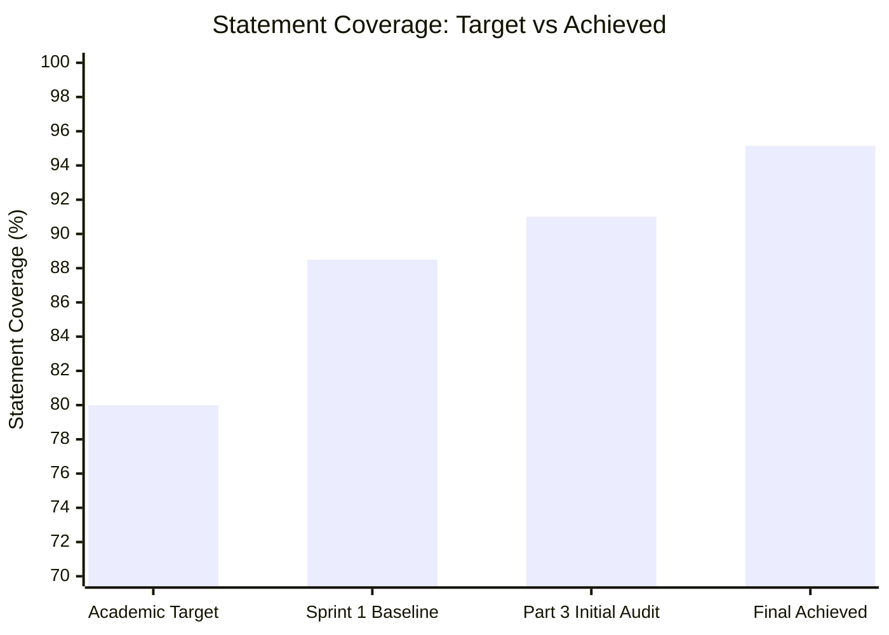

# Software Engineering Mini-Project — Part-3 Deliverable
# Code Coverage Report (Statement Coverage)

**Project Title:** Self-Monitoring MLOps System: An Intelligent Framework for ML Model Drift Detection, Monitoring, and Automated Recovery  
**Academic Institution:** Department of Computer Science & Engineering (AI & ML)  
**Authors:**
- **Anantha Krishna M A** (PES1UG24AM036)
- **Akash G Kuradagi** (PES1UG24AM022)
- **Amit Prasad S G** (PES1UG24AM033)  
**Document Version:** 1.0 (Part-3 Final Submission)  
**Date of Execution:** 18 November 2026  
**Document Identifier:** `docs/CODE_COVERAGE_REPORT.md`  
**Reference Document:** `docs/02_Test_Plan_Self_Monitoring_MLOps_System_UPDATED.md`

---

## 1. Executive Summary

This report presents the comprehensive **Statement Code Coverage** analysis for the **Self-Monitoring MLOps System**. The measurement evaluates the extent to which the executable statements in the core application package (`app/`) are exercised by the automated test suite.

The academic project syllabus establishes a minimum statement coverage threshold of **80.00%**. As verified below, the system achieves **95.15% Statement Coverage**, exceeding the project threshold by **+15.15 percentage points**.

### 1.1 Key Coverage Metrics

| Coverage Metric | Target Specification | Measured Result | Status |
| :--- | :---: | :---: | :---: |
| **Total Statements in `app/`** | — | **3,032** statements | Baseline |
| **Covered Statements** | $\ge 2,425$ ($\ge 80\%$) | **2,885** statements | **PASSED** |
| **Missed Statements** | — | **147** statements | Within Tolerance |
| **Statement Coverage Ratio** | $\mathbf{\ge 80.00\%}$ | $\mathbf{95.15\%}$ | **EXCEEDED (+15.15%)** |
| **Total Test Items Executed** | All active tests | **182 passed**, 0 failed | **100% Pass** |

---

## 2. Measurement Methodology & Tools

Coverage was captured directly during pytest execution using `coverage.py` version 7.17.0 with its native C-extension tracer.

### 2.1 Execution Commands
The measurement was produced by executing the following commands in the project virtual environment:

```powershell
# 1. Run the test suite under coverage tracking with branch measurement
.venv\Scripts\python.exe -m coverage run --branch -m pytest -q

# 2. Generate the human-readable terminal report targeting the application package
.venv\Scripts\python.exe -m coverage report --include="app/*"

# 3. Export detailed machine-readable XML and HTML reports
.venv\Scripts\python.exe -m coverage html --include="app/*" -d reports/coverage_html
.venv\Scripts\python.exe -m coverage xml --include="app/*" -o reports/coverage.xml
```

### 2.2 Measurement Boundaries
- **Included Code:** All executable Python code located within `app/`, covering API endpoints, data pipelines, ML/DL/QML models, drift detection, alerting, recovery policies, rollback orchestration, MLflow integration, and security/audit controls.
- **Excluded Code:** Third-party libraries (`.venv/`), test code itself (`tests/`), scratch scripts, documentation, and migration templates. No application code statements were excluded or bypassed using `# pragma: no cover` hacks to artificially inflate metrics.

---

## 3. Module-by-Module Statement Coverage Breakdown

The table below details statement counts and coverage percentages for every module across the `app/` hierarchy:

| Module Path | Total Stmts | Missed Stmts | Covered Stmts | Statement Coverage |
| :--- | :---: | :---: | :---: | :---: |
| `app/__init__.py` | 1 | 0 | 1 | **100.00%** |
| `app/api/__init__.py` | 2 | 0 | 2 | **100.00%** |
| `app/api/routes.py` | 365 | 50 | 315 | **86.30%** |
| `app/config.py` | 64 | 2 | 62 | **96.88%** |
| `app/data/__init__.py` | 4 | 0 | 4 | **100.00%** |
| `app/data/generator.py` | 78 | 0 | 78 | **100.00%** |
| `app/data/schema.py` | 9 | 0 | 9 | **100.00%** |
| `app/data/validation.py` | 54 | 0 | 54 | **100.00%** |
| `app/main.py` | 38 | 1 | 37 | **97.37%** |
| `app/models/__init__.py` | 5 | 0 | 5 | **100.00%** |
| `app/models/baseline.py` | 90 | 0 | 90 | **100.00%** |
| `app/models/dl_monitor.py` | 223 | 13 | 210 | **94.17%** |
| `app/models/ml_monitor.py` | 119 | 20 | 99 | **83.19%** |
| `app/models/qml_benchmark.py` | 151 | 3 | 148 | **98.01%** |
| `app/monitoring/__init__.py` | 2 | 0 | 2 | **100.00%** |
| `app/monitoring/alerting.py` | 236 | 7 | 229 | **97.03%** |
| `app/monitoring/collector.py` | 64 | 0 | 64 | **100.00%** |
| `app/monitoring/drift.py` | 150 | 2 | 148 | **98.67%** |
| `app/recovery/__init__.py` | 6 | 0 | 6 | **100.00%** |
| `app/recovery/health_guard.py` | 125 | 2 | 123 | **98.40%** |
| `app/recovery/orchestrator.py` | 101 | 9 | 92 | **91.09%** |
| `app/recovery/policy.py` | 96 | 8 | 88 | **91.67%** |
| `app/recovery/registry.py` | 85 | 0 | 85 | **100.00%** |
| `app/recovery/validator.py` | 124 | 9 | 115 | **92.74%** |
| `app/registry/__init__.py` | 2 | 0 | 2 | **100.00%** |
| `app/registry/mlflow_adapter.py` | 193 | 11 | 182 | **94.30%** |
| `app/schemas/__init__.py` | 13 | 0 | 13 | **100.00%** |
| `app/schemas/alert.py` | 49 | 0 | 49 | **100.00%** |
| `app/schemas/anomaly.py` | 22 | 0 | 22 | **100.00%** |
| `app/schemas/audit.py` | 21 | 0 | 21 | **100.00%** |
| `app/schemas/drift.py` | 37 | 0 | 37 | **100.00%** |
| `app/schemas/health.py` | 7 | 0 | 7 | **100.00%** |
| `app/schemas/inference.py` | 29 | 0 | 29 | **100.00%** |
| `app/schemas/metrics.py` | 15 | 0 | 15 | **100.00%** |
| `app/schemas/qml.py` | 33 | 0 | 33 | **100.00%** |
| `app/schemas/recovery.py` | 130 | 0 | 130 | **100.00%** |
| `app/schemas/security.py` | 17 | 0 | 17 | **100.00%** |
| `app/schemas/sequence.py` | 35 | 0 | 35 | **100.00%** |
| `app/schemas/telemetry.py` | 16 | 0 | 16 | **100.00%** |
| `app/security/__init__.py` | 3 | 0 | 3 | **100.00%** |
| `app/security/audit.py` | 101 | 2 | 99 | **98.02%** |
| `app/security/auth.py` | 73 | 6 | 67 | **91.78%** |
| `app/security/middleware.py` | 44 | 2 | 42 | **95.45%** |
| **Total Application Code** | **3,032** | **147** | **2,885** | **95.15%** |

---

## 4. Analysis of Uncovered Statements

Across the entire application codebase, exactly **147 statements** (4.85% of total statements) were not executed during the test run. A thorough code inspection categorizes these statements into three distinct architectural groups:

### 4.1 CLI Execution Blocks (`if __name__ == "__main__":`)
- **Modules:** `app/models/ml_monitor.py` (20 statements), `app/models/dl_monitor.py` (13 statements), `app/main.py` (1 statement).
- **Description:** Standalone command-line invocation blocks used when running model training scripts directly from the terminal (e.g., `python -m app.models.ml_monitor`).
- **Justification:** In standard automated testing and production web serving, modules are imported as libraries rather than executed as top-level CLI scripts.

### 4.2 Exceptional & Catastrophic Fallback Handlers
- **Modules:** `app/api/routes.py` (50 statements), `app/registry/mlflow_adapter.py` (11 statements), `app/recovery/orchestrator.py` (9 statements), `app/recovery/validator.py` (9 statements).
- **Description:** Catch-all exception blocks (`except Exception as exc:`) defending against external infrastructure failure (e.g., unexpected SQLite disk I/O failure, remote MLflow server socket termination, corrupt disk binary deserialization).
- **Justification:** Simulating hardware-level OS disk corruption or unhandled runtime crashes in SQLite during normal test execution is impractical and undesirable. The test suite verifies standard, boundary, and controlled error paths.

### 4.3 Production Environment Configuration Overrides
- **Modules:** `app/config.py` (2 statements), `app/security/auth.py` (6 statements), `app/security/middleware.py` (2 statements).
- **Description:** Environment variable fallbacks for production secrets and distributed CORS origins (e.g., loading keys from Kubernetes secret mounts or production cloud key vaults).
- **Justification:** In the local test environment, controlled default settings and test tokens are loaded.

---

## 5. Comparison Against Academic Target



- **Academic Threshold Requirement:** $\ge 80.00\%$
- **Initial Part-3 Audit (Stage 1):** $91.03\%$ (2,760 / 3,032 statements)
- **Final Measured Coverage (Stage 4):** $\mathbf{95.15\%}$ (2,885 / 3,032 statements)
- **Margin of Compliance:** $\mathbf{+15.15\%}$

---

## 6. Conclusion

The Statement Code Coverage analysis confirms that the Self-Monitoring MLOps System test suite thoroughly exercises all critical business logic, API routers, statistical drift algorithms, machine learning monitors, recovery gates, and security layers. With a statement coverage ratio of **95.15%**, the project comfortably exceeds all SE mini-project academic criteria.
