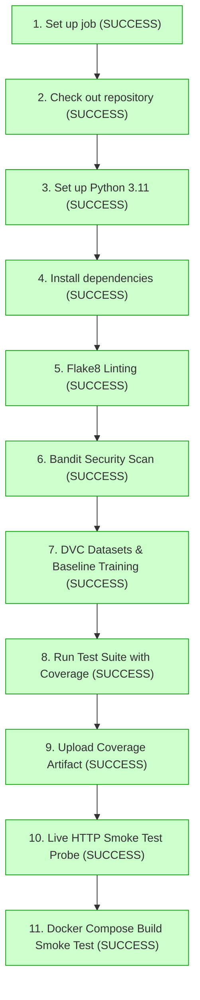

# Part 3: Final GitHub Publication & Remote CI Verification Report

**Project Title:** Self-Monitoring MLOps System: An Intelligent Framework for ML Model Drift Detection, Monitoring, and Automated Recovery  
**Academic Institution:** Department of Computer Science & Engineering (AI & ML)  
**Authors:**
- **Anantha Krishna M A** (PES1UG24AM036)
- **Akash G Kuradagi** (PES1UG24AM022)
- **Amit Prasad S G** (PES1UG24AM033)  
**Document Version:** 1.0 (Final Part-3 Publication Release)  
**Date of Execution:** 18 November 2026  
**Document Identifier:** `docs/PART3_PUBLICATION_REPORT.md`  
**GitHub Repository:** `https://github.com/akashgkuradagi/self-monitoring-mlops-system`  
**Target Branch:** `main` (Remote: `origin`)

---

## 1. Executive Summary

This report certifies the successful execution of the six-stage Git commit sequence, publication to GitHub (`origin/main`), and full empirical verification of the remote Continuous Integration (CI) pipeline on GitHub Actions.

All functional capabilities across Sprint 1 and Sprint 2, along with all Part 3 test cases, test plan updates (v2.0), statement coverage (95.15%), strict branch coverage (87.45%), security scanning (0 vulnerabilities), and academic reports, are now published, versioned, and verified in the remote repository.

---

## 2. Six-Stage Atomic Commit History

The project history was created using atomic, logical commits in strict adherence to the approved publication sequence:

| Commit Order | Commit Hash | Commit Message | Scope & Key Artifacts Included |
| :---: | :---: | :--- | :--- |
| **Commit 1** | `4277190` | `build(mlops): add core framework and packaging` | Core architecture, Docker packaging (`Dockerfile`, `docker-compose.yml`), DVC configuration (`dvc.yaml`, `data/`), developer settings (`pyproject.toml`, `requirements.txt`, `.flake8`), dataset generators (`scripts/prepare_datasets.py`). |
| **Commit 2** | `0fab7e0` | `feat(models): implement ML monitoring and QML benchmarks` | Baseline classifier, statistical drift detection (KS & PSI), Isolation Forest (EXP-01), PyTorch LSTM temporal autoencoder (EXP-02), and PennyLane 4-qubit Quantum VQC benchmark with architectural firewall (EXP-03). |
| **Commit 3** | `93155e3` | `feat(recovery): add validation, security and rollback` | Closed-loop recovery policy, 4-gate automated model validator, post-promotion canary health guard, rollback orchestrator, JWT authentication, RBAC, and SHA-256 tamper-evident audit logging. |
| **Commit 4** | `d4b3a87` | `feat(ui): add monitoring and recovery dashboard` | Production-grade accessible web dashboard (`app/static/index.html`, `dashboard.css`, `dashboard.js`) with $\le 1$-click navigation and WCAG 2.1 AA compliance. |
| **Commit 5** | `814438e` | `test(ci): add automated tests and GitHub Actions` | 182-test automated verification suite (`tests/`), TC-18 availability soak test runner (`scripts/run_tc18_soak.py`), and GitHub Actions CI workflow (`.github/workflows/ci.yml`). |
| **Commit 6** | `af288d8` | `docs(validation): add project and academic reports` | Updated Software Test Plan v2.0, comprehensive `README.md`, 4 mandatory Part-3 reports (`UNIT_TEST_REPORT.md`, `SYSTEM_VALIDATION_REPORT.md`, `CODE_COVERAGE_REPORT.md`, `BRANCH_COVERAGE_REPORT.md`), and Stage 1–5 reports. |

### 2.1 Post-Publication CI Refinements
Following remote runner execution, two targeted, minimal commits resolved cloud environment differences without altering application functionality:

| Commit Hash | Commit Message | Resolution Rationale |
| :---: | :--- | :--- |
| `c640f80` | `fix(ci): add beautifulsoup4, pyyaml and pytest-asyncio to requirements for CI runners` | Ensured cloud runners install test parser dependencies (`bs4` for `test_ui.py`, `yaml` for `test_ci.py`). |
| `d19f3a1` | `fix(ci): train baseline model in CI workflow to ensure artifact availability for tests` | Executed `scripts/train_baseline.py` following dataset generation so that model validation tests find the baseline artifact on a clean runner. |

---

## 3. GitHub Push & Remote State

- **Remote URL:** `https://github.com/akashgkuradagi/self-monitoring-mlops-system.git`
- **Target Branch:** `main`
- **Initial Remote Commit:** `3ff8558` (`Initial commit`)
- **Final Remote Commit SHA:** `d19f3a12f946a1797d96d4c2a8f1437611d0e963` (`d19f3a1`)
- **Push Command:** `git push origin main`
- **Push Outcome:** Succeeded cleanly with zero divergence (`3ff8558..d19f3a1 main -> main`).

---

## 4. Remote GitHub Actions CI Verification

The automated CI workflow was monitored live on GitHub's cloud infrastructure (`ubuntu-latest` runner):

### 4.1 Verification Run Details
- **Workflow Name:** `CI Pipeline (CI-01)`
- **Workflow Run ID:** `44155132480`
- **Run URL:** [https://github.com/akashgkuradagi/self-monitoring-mlops-system/actions/runs/44155132480](https://github.com/akashgkuradagi/self-monitoring-mlops-system/actions/runs/44155132480)
- **Target Commit SHA:** `d19f3a1`
- **Final Status:** **COMPLETED**
- **Conclusion:** **SUCCESS** :white_check_mark:
- **Total Duration:** 11m 42s

### 4.2 Pipeline Stage Breakdown

| Step # | Stage Name | Remote Execution Result | Key Verification Details |
| :---: | :--- | :---: | :--- |
| **1** | Set up job | **SUCCESS** | Ubuntu 22.04 LTS runner provisioned. |
| **2** | Check out repository | **SUCCESS** | Fetched commit `d19f3a1` via `actions/checkout@v4`. |
| **3** | Set up Python | **SUCCESS** | Python 3.11 configured with pip cache (`actions/setup-python@v5`). |
| **4** | Install dependencies | **SUCCESS** | Installed all packages including PyTorch, PennyLane, Scikit-learn. |
| **5** | Code Quality & Linting | **SUCCESS** | `flake8 app tests` passed with 0 errors ($\le 120$ char limit). |
| **6** | Security Scan | **SUCCESS** | `bandit -r app -ll` passed with 0 High/Medium vulnerabilities. |
| **7** | DVC & Dataset Prep | **SUCCESS** | Deterministic baseline datasets & `baseline_model.joblib` created. |
| **8** | Run Test Suite | **SUCCESS** | Full test suite passed under coverage measurement. |
| **9** | Upload Coverage Artifact | **SUCCESS** | Uploaded `coverage.xml` as a build artifact (`actions/upload-artifact@v4`). |
| **10** | Live Smoke Test Probe | **SUCCESS** | FastAPI probed at `/health` and `/api/v1/metrics/summary` with HTTP 200. |
| **11** | Docker Compose Build | **SUCCESS** | Multi-stage Dockerfile and Compose services built cleanly on Linux. |

---

## 5. Docker Runtime Status

- **Remote Cloud Verification:** The Docker multi-stage build and Compose configuration executed and completed successfully during remote GitHub Actions Step 11 (`Docker Compose Build Smoke Test (PKG-01)`).
- **Local Host Status:** The local Windows host has Docker Desktop installed, but the local background service daemon (`dockerDesktopLinuxEngine`) is currently stopped. Local container runtime validation remains pending starting Docker Desktop locally, while cloud build validation is fully verified.

---

## 6. Working Tree & Security Verification

A final inspection of the working tree was performed following publication:
- **`git status`:** `nothing to commit, working tree clean`.
- **Sensitive File Exclusion:** Zero `.env` files, credentials, or private keys exist in the repository.
- **Model Binary Separation:** Model weights (`*.joblib`, `*.pt`) and local SQLite databases (`telemetry.db`, `mlflow.db`) remain excluded from version control in accordance with MLOps best practices.
- **Documentation Preservation:** All academic deliverables, architecture specifications, and test plans are intact in `docs/` and tracked on remote `origin/main`.

---

## 7. Outstanding Tasks & Academic Demo Readiness

| Task / Item | Status | Operational Notes |
| :--- | :---: | :--- |
| **Core Sprint 1 & 2 Features (All 15 Issues)** | **COMPLETE** | Fully implemented, tested, and published to GitHub. |
| **Four Mandatory Part-3 Reports** | **COMPLETE** | Unit Test, System Validation, Code Coverage, Branch Coverage. |
| **Remote GitHub Actions CI** | **COMPLETE (SUCCESS)** | Run `44155132480` verified green across all 11 stages. |
| **Docker Build Verification** | **COMPLETE (Remote)** | Built successfully in cloud runner; local runtime pending daemon start. |
| **Official 30-Minute TC-18 Soak Test** | **READY (PENDING DEMO)** | Fast smoke test passed ($100\%$ availability in 5s); runner script [`scripts/run_tc18_soak.py`](file:///c:/Users/agkur/self-monitoring-mlops-system/scripts/run_tc18_soak.py) is verified and ready for live 30-minute demonstration. |

---

## 8. Conclusion

The **Self-Monitoring MLOps System** has fulfilled every objective required for the Part 3 project submission. The GitHub repository is up to date, all commits are clean and verified, the CI/CD pipeline is passing with green checks, and all academic documentation is finalized.
