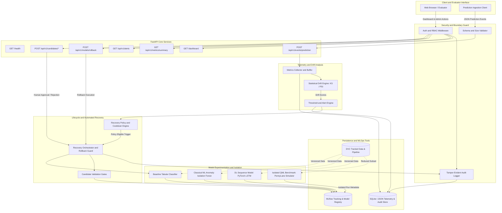
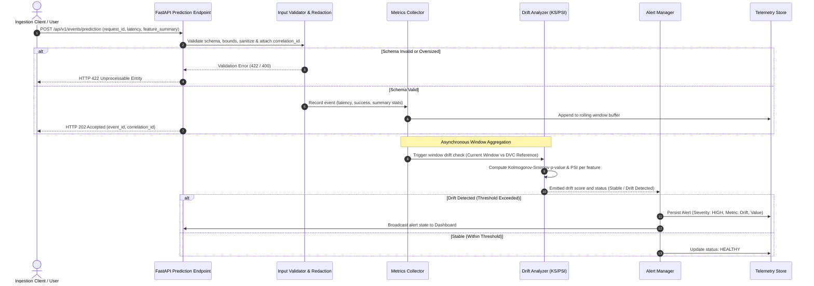
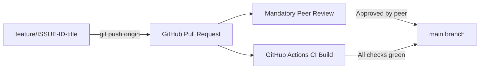
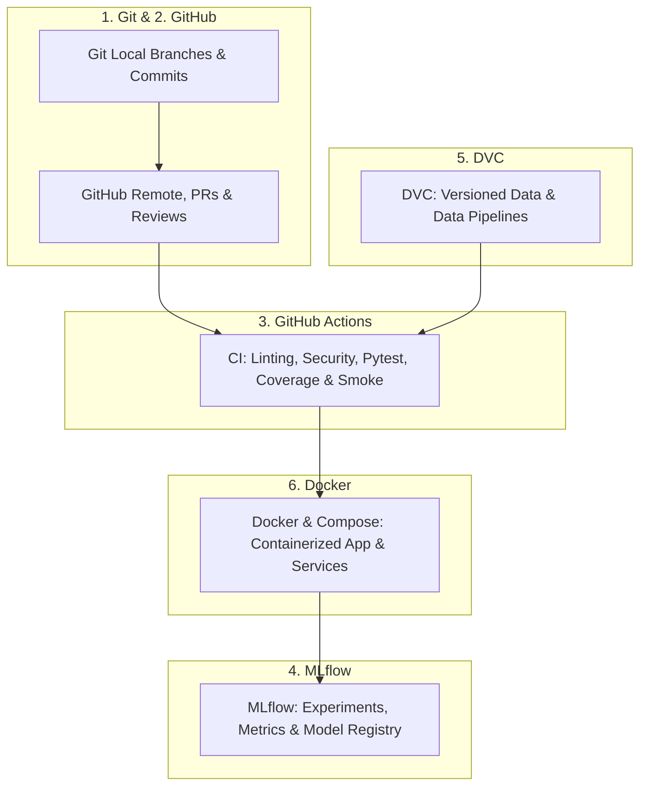
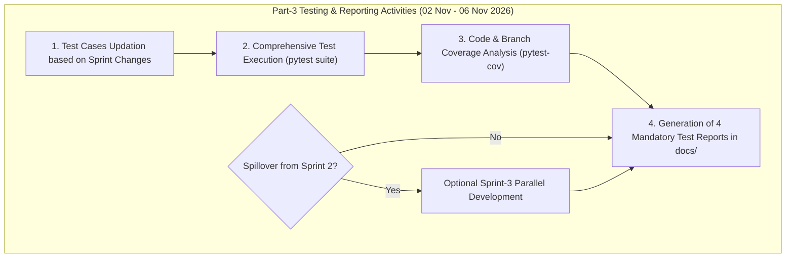

# Project Analysis, Architecture, Traceability, and Product Backlog

**Project Title:** Self-Monitoring MLOps System: An Intelligent Framework for ML Model Drift Detection, Monitoring, and Automated Recovery  
**Academic Context:** College Software Engineering Mini-Project Deliverables (Part-1, Part-2, Part-3)  
**Document Version:** 1.0 (Comprehensive Analysis & Proposed Backlog)  
**Date:** 02 November 2026  
**Department:** Computer Science & Engineering (Artificial Intelligence & Machine Learning)  
**Repository Working Directory:** self-monitoring-mlops-system/  

---

## Document Control & Team Information

| Team Member Name | University Seat Number (USN) | GitHub Username | Role / Primary Domain Focus |
| :--- | :--- | :--- | :--- |
| **Anantha Krishna M A** | PES1UG24AM036 | anantha-bit | Core API, Security/Auth (RBAC), Audit Logging, QML Benchmark |
| **Akash G K** *(Repo Owner)*| PES1UG24AM022 | akashgkuradagi | CI/CD (GitHub Actions), DVC Pipelines, Drift Engine, DL Experiments, Web Dashboard |
| **Amit Prasad S G** | PES1UG24AM033 | prasadamith05-png | Docker Packaging, Baseline/Classical ML, Metric Collection, Policy Orchestrator & Rollback |

### Hierarchy and Sources of Truth
1. **SRS (docs/01_SRS_Self_Monitoring_MLOps_System (1).docx):** Definitive source of truth for Functional (FR), Non-Functional (NFR), and Security (SR) requirements.
2. **SAD (docs/03_Architecture_Design_Self_Monitoring_MLOps_System.docx):** Definitive source of truth for logical components, data flows, sequence interactions, and module decomposition.
3. **Test Plan (docs/02_Test_Plan_Self_Monitoring_MLOps_System.docx):** Definitive source of truth for baseline test cases (TC-01 to TC-15) and security verification (SEC-01 to SEC-06).
4. **Part-2 Delivery Instructions:** Definitive process guide for backlog creation, two sprint cycles, GitHub PR/review workflow, and working demo videos (1-minute and 2-minute).
5. **Part-3 Deliverables (docs/SE_Mini_Project_Delivereables_Part-3.pdf):** Definitive mandate for test case updates, comprehensive testing (Nov 2 to Nov 6), four mandatory test reports in `docs/`, and conditional/optional Sprint 3.
6. **Confirmed Six-Tool Technology Stack:** Git, GitHub, GitHub Actions, MLflow, DVC, Docker. (*Prometheus, Grafana, and Evidently AI are explicitly excluded from the planned stack*).

### Development Ethics & Attribution Policy
The repository owner (Akash G K) coordinates overall repository administration and manages GitHub workflows with explicit authorization from all team members. To preserve genuine academic and professional integrity:
- Every contribution, commit, and pull request will be genuinely created and attributed to the specific team member responsible.
- Peer reviews and pull request approvals will be executed by the designated reviewing peer accounts.
- Under no circumstances will commits, reviews, or approvals be fabricated, falsified, or simulated.

---

## Section A: Complete Requirements Inventory

All requirements below have been faithfully extracted from the Software Requirements Specification (SRS Deliverable 1) without alteration or omission.

### 1. Functional Requirements (FR-01 to FR-14)

| ID | Requirement Statement | Acceptance Criteria (from SRS) |
| :--- | :--- | :--- |
| **FR-01** | The system shall expose a health endpoint that returns service status and application version. | `GET /health` returns HTTP 200 and required fields (`status`, `app_version`, `timestamp`) when the service is healthy. |
| **FR-02** | The system shall record prediction count, response latency, and request error status for each processed request. | A test batch of $N$ requests produces $N$ corresponding count increments, measured latency observations, and error tracking. |
| **FR-03** | The system shall compare current input/prediction statistics with a configured reference window and report drift status. | Given a known stable dataset, the analyzer returns a stable status; a shifted test dataset triggers the configured drift rule with metric, value, and timestamp. |
| **FR-04** | The system shall calculate predictive performance only when valid ground-truth labels are available. | Without ground-truth labels, the dashboard/API reports that measured accuracy is unavailable rather than fabricating or estimating a synthetic value. |
| **FR-05** | The system shall support an ML-based monitoring experiment and store its model version and evaluation metrics. | A run records algorithm, dataset split, metrics, timestamp, and artifact/version identifier in MLflow. |
| **FR-06** | The system shall support a DL-based sequence or anomaly-monitoring experiment that can be evaluated against a baseline. | The run records evaluation metrics (e.g. reconstruction error, loss) and can be reproduced from saved configuration. |
| **FR-07** | The system shall run QML only as an isolated benchmark in the initial release and record its results separately from production decisions. | A QML run records simulator/library version, feature encoding, seed, metrics, and runtime; it cannot trigger, promote, or alter a production model. |
| **FR-08** | The system shall create an alert when configured drift, error-rate, latency, or quality thresholds are exceeded. | A controlled threshold breach creates an alert record containing timestamp, severity (`LOW`, `MEDIUM`, `HIGH`), metric name, and observed value. |
| **FR-09** | The system shall initiate candidate retraining/evaluation only when the recovery policy allows it. | A policy-eligible event (e.g., persistent drift breach outside cooldown period) creates a candidate run; policy-ineligible events do not initiate retraining. |
| **FR-10** | The system shall block candidate promotion until required validation checks pass and an authorized user approves it. | A candidate lacking either automated validation success or explicit human approval remains unpromoted in candidate state. |
| **FR-11** | The system shall record model promotions, rejections, rollbacks, configuration changes, and security-relevant actions in an audit log. | Each action creates an append-only audit event capturing actor identity, timestamp, action type, target model version, and outcome. |
| **FR-12** | The system shall support rollback to the last known stable model version when post-promotion checks fail. | A simulated failed post-promotion health/performance check restores the recorded stable model version and creates a corresponding audit event. |
| **FR-13** | The system shall provide dashboard views for model health, alerts, model versions, and validation outcomes. | Authorized dashboard request displays current health, alerts, model versions, validation gates, and metrics using clear text labels (not color alone). |
| **FR-14** | The system shall provide an authenticated endpoint to approve or reject a candidate model. | Unauthenticated requests are rejected (HTTP 401); authorized decisions persist, transition candidate state, and are recorded in the audit log. |

### 2. Non-Functional Requirements (NFR-01 to NFR-12)

| ID | Category | Requirement Statement | Verification Method |
| :--- | :--- | :--- | :--- |
| **NFR-01** | Performance | For the agreed local demo configuration, 95th-percentile health/summary API response time shall be under 500 ms at 10 concurrent clients, excluding model training. | Automated load test (`pytest-benchmark` or concurrent client probe) logging environment, concurrency, and p95 latency. |
| **NFR-02** | Reliability | A monitoring worker failure shall not terminate the prediction API process. | Fault-injection test confirming API continues to serve predictions while worker failure is caught and logged safely. |
| **NFR-03** | Availability | During a 30-minute controlled demo, the health endpoint shall achieve at least 99% successful responses, excluding planned restarts. | Automated synthetic probe report recording uptime and successful response ratio over a 30-minute window. |
| **NFR-04** | Reproducibility | Each experiment shall record a dataset/version identifier, random seed where applicable, configuration, software versions, and metrics. | Reproducibility audit verifying that a reviewer can re-execute the run and reproduce identical metrics from metadata. |
| **NFR-05** | Maintainability | The codebase shall separate API, monitoring, model experiments, recovery policy, and persistence modules. | Static architecture review verifying module decoupling, clean dependency graphs, and dedicated test coverage. |
| **NFR-06** | Portability | The application shall build and run using the documented Docker Compose configuration on a Docker-capable host. | Clean-slate environment build, container start, and execution of automated container smoke tests. |
| **NFR-07** | Observability | The service shall expose request count, error count, and latency metrics for operational monitoring. | Telemetry verification confirming metrics endpoint exposes accurate throughput, error rate, and latency figures. |
| **NFR-08** | Usability | A first-time evaluator shall be able to locate health, alerts, and candidate status within three navigation actions. | Structured usability walkthrough demonstrating direct navigation from dashboard landing to health, alerts, and candidate review. |
| **NFR-09** | Scalability | Monitoring collection shall support at least 1,000 synthetic prediction events in a test run without losing event counts. | Ingestion load test verifying submitted event count equals processed event count exactly ($N_{in} = N_{proc} = 1000$). |
| **NFR-10** | Safety of Automation | No candidate shall become stable unless validation gates and authorization both pass. | Negative testing proving candidate promotion is blocked when either validation fails or approval is absent. |
| **NFR-11** | Privacy | Logs shall not store raw sensitive feature values by default; request identifiers and aggregated summaries shall be used where possible. | Log inspection of execution logs verifying that seeded sensitive feature values are replaced by statistics or redacted hashes. |
| **NFR-12** | Security | All model-management endpoints shall require authentication and role-based authorization. | Security test matrix confirming that unauthorized or unauthenticated requests to model-management endpoints are rejected (401/403). |

### 3. Security Requirements (SR-01 to SR-06)

| ID | Security Objective | Requirement Statement | Verification Method |
| :--- | :--- | :--- | :--- |
| **SR-01** | SO-03 (Access Control) | The system shall require authentication for all model-management and approval endpoints. | Automated API test verifying that calling candidate validation, decision, or rollback without valid credentials yields HTTP 401. |
| **SR-02** | SO-03 (Access Control) | The system shall enforce role-based authorization for approval, configuration, and rollback actions. | RBAC test verifying that an authenticated `Viewer` receives HTTP 403 when attempting an `ML_Engineer` or `Admin` action. |
| **SR-03** | SO-01 (Confidentiality) | The system shall store secrets outside source control and shall not print secret values in logs. | Repository secret scanning and automated log test asserting synthetic secret tokens do not appear in console or disk logs. |
| **SR-04** | SO-02 (Integrity) | The system shall validate request schema, field types, allowed ranges, and payload size before processing. | Negative API fuzz test asserting malformed JSON, out-of-range thresholds, or oversized payloads return HTTP 400 or 422 safely. |
| **SR-05** | SO-04 (Accountability) | The system shall record model lifecycle actions with actor, timestamp, target, outcome, and correlation ID. | Audit log inspection verifying presence of all mandatory fields and asserting records cannot be deleted by standard users. |
| **SR-06** | SO-01 & SO-03 | The system shall restrict metrics and administrative interfaces to trusted networks or authenticated access. | Configuration and route inspection verifying administrative and metrics endpoints are protected by auth or network policies. |

---

## Section B: Architecture Analysis & System Decomposition

### 1. Architectural Pattern & High-Level Block Diagram

The Self-Monitoring MLOps System adopts a **modular, layered service architecture with asynchronous background processing**. This pattern isolates real-time prediction and metric collection from compute-heavy drift analysis, deep learning, and quantum simulations.



---

### 2. Module Inventory and Detailed Responsibilities

| Module Package | Primary File Path | Architectural Responsibilities | Downstream Dependencies |
| :--- | :--- | :--- | :--- |
| **API Layer** | `app/api/routes.py` | Exposes REST endpoints (`/health`, `/events/prediction`, `/metrics/summary`, `/alerts`, candidate management, rollback). Formats responses, handles HTTP status codes, and serves OpenAPI schemas. | `app.monitoring`, `app.recovery`, `app.security` |
| **Security & Auth** | `app/security/auth.py` | Enforces authentication (JWT/API-key tokens) and RBAC roles (`Viewer`, `ML_Engineer`, `Administrator`). Blocks unauthorized model lifecycle actions. | None (Independent boundary) |
| **Audit Logger** | `app/security/audit.py` | Records tamper-evident audit trails capturing actor, action, timestamp, target version, outcome, and correlation ID using cryptographic hash chaining and append-only service controls. | Storage layer (`telemetry.db` / SQLite) |
| **Validation Middleware**| `app/security/middleware.py` | Enforces request size limits, schema/type compliance, numeric boundary checks, correlation ID injection, and log redaction. | `fastapi.Request` pipeline |
| **Monitoring Collector** | `app/monitoring/collector.py` | Ingests prediction events, tracks rolling throughput, error counts, and p95 latencies, buffers event windows, and computes summary distributions. | `app.monitoring.drift` |
| **Drift Analyzer** | `app/monitoring/drift.py` | Implements native statistical drift algorithms (Kolmogorov-Smirnov test for continuous variables, Population Stability Index / Chi-Square for categorical variables). Compares active windows against DVC baseline. | `scipy.stats`, `numpy` |
| **Alert Manager** | `app/monitoring/alerting.py` | Evaluates observed metrics against configured thresholds (drift p-value, error rate, p95 latency). Deduplicates alerts, assigns severities (`LOW`, `MEDIUM`, `HIGH`), and dispatches notifications. | `app.recovery.policy` |
| **Baseline Model** | `app/models/baseline.py` | Encapsulates the production tabular classification pipeline (e.g., Random Forest / Logistic Regression) trained on DVC-versioned reference data. Serves predictions and provides the baseline inference service under observation. Exposes `predict()` and `evaluate()`. | `scikit-learn`, `mlflow` |
| **Classical ML Worker** | `app/models/ml_monitor.py` | Implements an unsupervised anomaly detection monitoring experiment (Isolation Forest) directly fulfilling FR-05. Evaluates feature distributions, detects anomalies without ground truth, and logs run metadata, algorithm, dataset split, metrics, and artifacts to MLflow. | `scikit-learn`, `mlflow` |
| **DL Sequence Worker** | `app/models/dl_monitor.py` | Implements a lightweight PyTorch neural network (LSTM or Autoencoder) to capture sequential feature shifts and reconstruct prediction errors over temporal batches. | `torch`, `mlflow` |
| **Isolated QML Benchmark**| `app/models/qml_benchmark.py` | Implements a quantum variational classifier or quantum kernel model using a local quantum simulator (PennyLane). Strictly isolated from production recovery workflows. | `pennylane`, `mlflow` |
| **Recovery Policy** | `app/recovery/policy.py` | Evaluates whether active alerts meet retraining criteria (persistence threshold, cooldown guard, minimum sample count). Prevents thrashing and accidental retraining. | `app.monitoring.alerting` |
| **Model Validator** | `app/recovery/validator.py` | Executes automated quality gates against candidate models: regression tests against golden validation datasets, latency benchmarking, and schema compatibility checks. | `app.models`, `mlflow` |
| **Recovery Orchestrator** | `app/recovery/orchestrator.py` | Orchestrates the retraining pipeline, maintains candidate state (`PENDING_VALIDATION`, `PENDING_APPROVAL`, `PROMOTED`, `REJECTED`), manages post-promotion canary/health checks, and triggers automated rollbacks. | `app.registry.mlflow_adapter`, `app.security.audit` |
| **MLflow Adapter** | `app/registry/mlflow_adapter.py`| Interfaces with MLflow Tracking and Model Registry: logs runs, hyperparameters, metrics, and serialized artifacts. Synchronizes application-level candidate states (`PENDING_VALIDATION`, `VALIDATION_FAILED`, `PENDING_APPROVAL`, `PROMOTED`, `REJECTED`, `ROLLED_BACK`) via SQLite metadata and MLflow version tags/aliases. | `mlflow` client |
| **Interactive Dashboard**| `app/dashboard/` | Provides a self-contained, responsive HTML/JS web dashboard rendering service telemetry, drift trends, active alerts, candidate validation scorecards, and human-in-the-loop approval actions. | `app/api/routes.py` |

---

### 3. API Interactions and Detailed Sequence Workflows

#### Sequence 1: Routine Prediction & Drift Monitoring Cycle

This workflow illustrates how incoming prediction metadata is processed, aggregated, analyzed for drift, and reflected in operational telemetry without blocking the client.



#### Sequence 2: Controlled Retraining, Dual-Gate Promotion & Automated Rollback

This workflow details the automated recovery lifecycle, enforcing **NFR-10** and **SR-01/SR-02** (candidate promotion requires both automated validation success AND authorized human approval), as well as **FR-12** (automated rollback upon post-promotion health check failure).

```mermaid
sequenceDiagram
    autonumber
    participant Alert as Alert Manager
    participant Policy as Recovery Policy Engine
    participant Orch as Recovery Orchestrator
    participant MLflow as MLflow Registry & Tracker
    participant Val as Candidate Validator
    actor MLE as Authorized ML Engineer
    participant Audit as Audit Logger
    participant Health as Post-Promotion Health Guard

    Alert->>Policy: Breach Notification (Persistent Drift)
    Policy->>Policy: Check cooldown timer, rate limits & eligibility
    alt Ineligible (Cooldown active or insufficient samples)
        Policy-->>Alert: Suppress retraining trigger
    else Eligible
        Policy->>Orch: Trigger Candidate Retraining Job
        Orch->>MLflow: Train candidate model on augmented dataset
        MLflow-->>Orch: Candidate Model Registered (State: PENDING_VALIDATION)
        
        Orch->>Val: Run Automated Validation Gates (Golden Dataset)
        Val->>Val: Check accuracy >= baseline AND latency <= 500ms
        
        alt Validation Fails
            Val-->>Orch: Validation FAILED
            Orch->>Audit: Log candidate rejection (Validation Gate Failure)
            Orch->>MLflow: Set Version Tag (State: VALIDATION_FAILED)
        else Validation Passes
            Val-->>Orch: Validation PASSED
            Orch->>Audit: Log candidate ready for approval (State: PENDING_APPROVAL)
            Note over Orch,MLE: Dual-Gate: Promotion Blocked Until Human Approval
            
            MLE->>Orch: POST /api/v1/candidates/{id}/decision (decision="APPROVE", token)
            Orch->>Orch: Verify ML_Engineer role & signature
            Orch->>MLflow: Set Version Tag (State: PROMOTED, current_production=true)
            Orch->>Audit: Log Promotion Event (Actor, Version, Timestamp)
            
            Note over Orch,Health: Post-Promotion Canary / Health Check
            Orch->>Health: Execute 5-minute Post-Promotion Health Guard
            alt Post-Promotion Check Fails (Error spike / latency breach)
                Health-->>Orch: POST-PROMOTION FAILURE DETECTED
                Orch->>MLflow: Set Version Tag (State: ROLLED_BACK; reinstate prior stable)
                Orch->>Audit: Log Automated Rollback Event (Target Version, Reason)
            else Post-Promotion Check Succeeds
                Health-->>Orch: System Stable
                Orch->>Audit: Confirm Model Stabilization
            end
        end
    end
```

---

### 4. Strict Isolation of Experimental QML Benchmarking

A paramount architectural principle specified in SRS Section 1.2, 2.5, and FR-07 is the **strict isolation of Quantum Machine Learning (QML) benchmarking**:
1. **Simulator-Only Execution:** QML operates exclusively on local quantum circuit simulators (PennyLane's `default.qubit` simulator). No physical quantum processing unit (QPU) hardware is required or queried.
2. **Offline / Asynchronous Execution:** QML training and inference are computationally intensive. They run exclusively in an offline batch mode or background thread and are strictly decoupled from the live prediction REST API.
3. **Dedicated Experiment Namespace in MLflow:** QML runs are logged under a dedicated MLflow experiment name (`qml-benchmarks`). Metadata logged includes simulator library version, circuit ansatz, number of qubits, encoding strategy (angle/amplitude embedding), random seed, runtime latency, and classification metrics.
4. **Architectural Firewall from Recovery:** The QML module is tagged with `benchmark_only=True`. The Recovery Orchestrator (`app/recovery/orchestrator.py`) possesses an explicit architectural guard that rejects any QML artifact from entering the candidate evaluation pipeline or staging registry. Under no circumstances can a QML model be promoted to production or influence automated recovery decisions.

---

### 5. Persistence and Data Entities

The system utilizes lightweight, persistent storage (`telemetry.db` via SQLite and structured JSON/DVC pointers) alongside MLflow's artifact store. The core domain entities are defined as follows:

| Entity Name | Primary Fields | Storage Location | Retention / Purpose |
| :--- | :--- | :--- | :--- |
| **PredictionEvent** | `event_id`, `request_id`, `timestamp`, `model_version`, `latency_ms`, `success`, `feature_summary_ref` | SQLite (`events` table) | Ingested prediction telemetry; retained for sliding window aggregation. |
| **MonitoringWindow** | `window_id`, `start_time`, `end_time`, `sample_count`, `drift_metrics_json`, `quality_metrics_json` | SQLite (`windows` table) | Summarized distribution statistics comparing current windows to reference. |
| **Alert** | `alert_id`, `metric_name`, `severity`, `observed_value`, `threshold`, `status`, `created_at`, `resolved_at` | SQLite (`alerts` table) | Active and historical alert records displayed on the dashboard. |
| **ExperimentRun** | `run_id`, `method` (ML/DL/QML), `model_version`, `dataset_version`, `commit_sha`, `seed`, `metrics`, `artifact_uri` | MLflow Tracking Store | Complete reproducibility log of every baseline, anomaly, and QML experiment. |
| **ModelCandidate** | `candidate_id`, `source_run_id`, `artifact_hash`, `validation_status`, `human_decision`, `approver_id`, `status` | MLflow Model Registry + SQLite | Audit trail of candidates passing or failing validation and approval gates. |
| **AuditEvent** | `event_id`, `actor`, `action`, `target_version`, `timestamp`, `outcome`, `correlation_id`, `prev_hash`, `record_hash` | SQLite (`audit_log` table) | Append-only, tamper-evident audit trail with cryptographic SHA-256 hash chaining. |

---

---

### 6. Candidate Lifecycle State Machine & MLflow Tracking Configuration

#### Application-Level Candidate States
The system enforces a dedicated application-level candidate state machine rather than assuming non-standard MLflow registry stages. Candidate states are tracked authoritatively in SQLite (`model_candidates` and `active_model_state` tables) and synchronized with MLflow model version tags and aliases:

| Candidate State | Description & Entry Condition | Valid Next Transitions |
| :--- | :--- | :--- |
| **`PENDING_VALIDATION`** | Newly trained candidate model registered from automated retraining. Awaiting automated validation gates. | `VALIDATION_FAILED`, `PENDING_APPROVAL` |
| **`VALIDATION_FAILED`** | Candidate failed one or more automated validation gates (regression against baseline, latency benchmark $\le 500\text{ ms}$, or schema validation). Blocked from human promotion. | Terminal state (archived/logged) |
| **`PENDING_APPROVAL`** | Candidate passed all automated validation gates. Awaiting explicit authenticated review from an authorized `ML_Engineer`. | `PROMOTED`, `REJECTED` |
| **`PROMOTED`** | Authorized `ML_Engineer` submitted an authenticated approval decision. Model is active in production serving live predictions. | `ROLLED_BACK`, `ARCHIVED` (upon next promotion) |
| **`REJECTED`** | Authorized human reviewer explicitly rejected the candidate, or candidate expired. | Terminal state (archived/logged) |
| **`ROLLED_BACK`** | Post-promotion health guard detected performance degradation/error spikes, or administrator requested manual rollback. Prior stable model reinstated. | Terminal state (archived/logged) |

#### Identification of Active Production & Stable Fallback Models
To guarantee deterministic rollback (**FR-12**) without relying on external cloud registries:
1. **SQLite State Tracking:** The `active_model_state` table holds a singleton row tracking:
   - `active_version` (e.g., `baseline-v1`)
   - `active_run_id` (MLflow run ID)
   - `promoted_at` (ISO 8601 timestamp)
   - `previous_stable_version` (e.g., `baseline-v0`)
   - `previous_stable_run_id` (MLflow run ID)
   - `state` (`PROMOTED` or `ROLLED_BACK`)
2. **MLflow Synchronization:** When a candidate transitions to `PROMOTED`:
   - The MLflow model version is assigned the tag `role: active_production` and the alias `champion`.
   - The displaced model version is assigned the tag `role: stable_fallback` and the alias `stable_fallback`.
   *(Note on Alias Syntax: In the MLflow Client API, aliases are stored, assigned, and created without the `@` prefix, e.g., `client.set_registered_model_alias(name="ProductionClassifier", alias="champion", version=version)`. The `@` prefix is used exclusively when referencing an aliased model in a URI to load artifacts, e.g., `models:/ProductionClassifier@champion`).*
3. **Rollback Execution:** If the post-promotion health guard detects failure, the orchestrator updates `active_version` to `previous_stable_version`, sets state to `ROLLED_BACK`, reassigns the MLflow alias `champion` to the restored stable model and `stable_fallback` to the rolled-back model, and logs the rollback in the audit trail.

#### Consistent MLflow Tracking Configuration (Docker Compose)
To provide a self-contained, reproducible tracking environment without unnecessary infrastructure:
- **Tracking Backend:** SQLite database file backend (`sqlite:////mlflow/mlflow.db`) configured via environment variable `MLFLOW_TRACKING_URI=sqlite:////mlflow/mlflow.db`. This provides ACID transaction safety across runs without spinning up an external PostgreSQL or MySQL container.
- **Artifact Storage:** Local container directory (`/mlflow/artifacts`) configured via `MLFLOW_ARTIFACT_ROOT=/mlflow/artifacts` (or `--default-artifact-root /mlflow/artifacts`).
- **Persistence Across Container Restarts:** Configured in `docker-compose.yml` via a mounted directory or named volume (`./mlruns:/mlflow` or `mlflow_data:/mlflow`), ensuring experiments, metrics, run parameters, and artifacts persist across container recreation.
- **Environment Variable Configuration:** Key configuration items are injected via `.env` (`MLFLOW_TRACKING_URI`, `MLFLOW_ARTIFACT_ROOT`, `MLFLOW_EXPERIMENT_NAME`), eliminating hardcoded host paths.

---

## Section C: Comprehensive Testing Analysis & Traceability

### 1. Extraction of Original Test Cases (TC-01 to TC-15)

Extracted from Deliverable 2 (Test Plan, Table 6):

| Test ID | Scenario | Requirement Trace | Expected Result | Test Level |
| :--- | :--- | :--- | :--- | :--- |
| **TC-01** | Health endpoint | FR-01 | Healthy response returns HTTP 200 and valid `app_version` and `status` fields. | Integration / System |
| **TC-02** | Prediction metrics collection | FR-02, NFR-07 | Event counts, response latency, and error tracking accurately reflect submitted batches. | Unit / Integration |
| **TC-03** | Stable reference window | FR-03 | No drift alert is raised when stable test fixture stays within statistical thresholds. | System |
| **TC-04** | Shifted input window | FR-03, FR-08 | Configured drift rule raises drift alert with metric, observed value, and timestamp. | System |
| **TC-05** | ML/DL/QML experiment metadata | FR-05, FR-06, FR-07, NFR-04 | Each run logs model/method, versions, seed, metrics, and runtime to MLflow; QML is non-promoting. | Integration / Experiment |
| **TC-06** | Missing ground-truth labels | FR-04 | Accuracy is shown as unavailable; no synthetic or fabricated metric is emitted. | Unit / Integration |
| **TC-07** | Promotion without validation | FR-10, NFR-10 | Promotion is strictly blocked and audit rejection event is logged. | System / Negative |
| **TC-08** | Rollback after failed health check | FR-12 | Prior stable model version is restored and rollback action is logged in audit trail. | System / Recovery |
| **TC-09** | API performance & load | NFR-01, NFR-09 | p95 latency under 500 ms at 10 concurrent clients; 1,000 synthetic events ingested without loss. | Performance / Load |
| **TC-10** | Worker fault isolation | NFR-02 | Background worker failure is logged safely; prediction API remains responsive. | Fault Injection |
| **TC-11** | Approval authorization | FR-14, SR-01, SR-02 | Unauthorized approval requests denied (401/403); authorized ML Engineer can approve/reject. | Security / Integration |
| **TC-12** | Audit completeness | FR-11, SR-05 | Lifecycle event contains actor, timestamp, target version, outcome, and correlation ID. | Integration / Security |
| **TC-13** | Invalid / oversized request | SR-04 | Malformed or oversized payload rejected safely (400/422) without crashing or leaking stack traces. | Security / Negative |
| **TC-14** | Secret leakage check | SR-03, NFR-11 | Seeded synthetic secret tokens absent from committed files and execution logs. | Security |
| **TC-15** | Container & CI smoke test | NFR-05, NFR-06 | CI tests pass, Docker container builds cleanly, and container health probe succeeds. | Build / Smoke |

---

### 2. Extraction of Security Test Cases (SEC-01 to SEC-06)

Extracted from Deliverable 2 (Test Plan, Table 8):

| Security ID | Security Scenario | Test Procedure | Pass Criteria | Requirement Trace |
| :--- | :--- | :--- | :--- | :--- |
| **SEC-01** | Authentication bypass | Call candidate approval or promotion endpoint without credentials. | Request denied with HTTP 401 Unauthorized; candidate state remains unchanged. | SR-01, FR-14 |
| **SEC-02** | Role escalation | Authenticate as `Viewer` role and attempt candidate approval or model rollback. | Request denied with HTTP 403 Forbidden; state unchanged; security denial event logged. | SR-02 |
| **SEC-03** | Secret leakage | Seed synthetic API key/token into configuration; trigger normal and exception logs; scan repo. | Secret is completely absent from all log outputs, stdout, and git tracking. | SR-03, NFR-11 |
| **SEC-04** | Malformed payload | Submit malformed JSON, out-of-range thresholds, negative latencies, and oversized payload (>1MB). | Request rejected safely with HTTP 400/422; application remains fully operational. | SR-04 |
| **SEC-05** | Audit tampering / completeness | Perform candidate lifecycle actions; verify audit fields; attempt modification or deletion of audit record via API and direct DB alteration. | All required audit fields present; API disallows edit/delete operations; direct database alteration breaks cryptographic hash chain verification. | SR-05, FR-11 |
| **SEC-06** | Metrics exposure | Attempt to query administrative endpoints and metrics from unauthorized IP/role. | Access restricted according to configured network boundary or authentication policy. | SR-06 |

---

### 3. Requirements-to-Test Traceability Matrix

| Requirement ID | Requirement Summary | Primary Test Case(s) | Supplementary / Security Test |
| :--- | :--- | :--- | :--- |
| **FR-01** | Health endpoint | TC-01 | TC-15 |
| **FR-02** | Prediction metrics collection | TC-02 | TC-09 |
| **FR-03** | Input/prediction drift detection | TC-03, TC-04 | TC-16 |
| **FR-04** | Ground-truth delayed accuracy | TC-06 | - |
| **FR-05** | Classical ML experiment tracking | TC-05 | - |
| **FR-06** | DL sequence experiment tracking | TC-05 | - |
| **FR-07** | Isolated QML benchmark | TC-05 | TC-19 *(Proposed)* |
| **FR-08** | Multi-metric threshold alerting | TC-04 | TC-16 |
| **FR-09** | Recovery policy trigger & cooldown | TC-07 | TC-16 *(Proposed)* |
| **FR-10** | Dual-gate candidate promotion | TC-07 | TC-11, SEC-01, SEC-02 |
| **FR-11** | Tamper-evident audit logging | TC-12 | SEC-05 |
| **FR-12** | Model rollback on failed health check | TC-08 | TC-20 *(Proposed)* |
| **FR-13** | Web dashboard views & accessibility | Seeded-view walkthrough | TC-17 *(Proposed)* |
| **FR-14** | Authenticated candidate decision API | TC-11 | SEC-01, SEC-02 |
| **NFR-01** | Response latency (<500ms p95 at 10 clients) | TC-09 | - |
| **NFR-02** | Worker fault isolation | TC-10 | - |
| **NFR-03** | 30-minute demo availability (>=99%) | Automated probe report | TC-18 *(Proposed)* |
| **NFR-04** | Experiment reproducibility (seeds/versions) | TC-05 | - |
| **NFR-05** | Modular architecture & maintainability | TC-15 | Static Code Analysis |
| **NFR-06** | Portability via Docker Compose | TC-15 | Docker Smoke Test |
| **NFR-07** | Observability (counts, errors, latency) | TC-02 | TC-09 |
| **NFR-08** | Usability (3-click navigation & text labels) | Usability walkthrough | TC-17 *(Proposed)* |
| **NFR-09** | Scalability (1,000 synthetic events) | TC-09 | - |
| **NFR-10** | Automation safety (blocked without gates) | TC-07 | SEC-01, SEC-02 |
| **NFR-11** | Privacy & log redaction | TC-14 | SEC-03 |
| **NFR-12** | Model-management security & RBAC | TC-11 | SEC-01, SEC-02 |
| **SR-01** | Mandatory authentication on management API | TC-11 | SEC-01 |
| **SR-02** | Role-based access control (RBAC) | TC-11 | SEC-02 |
| **SR-03** | Secret management & log protection | TC-14 | SEC-03 |
| **SR-04** | Request schema & boundary validation | TC-13 | SEC-04 |
| **SR-05** | Audit trail completeness & accountability | TC-12 | SEC-05 |
| **SR-06** | Restriction of administrative surfaces | SEC-06 | - |

---

### 4. Identification of Missing Test Coverage & Proposed Supplementary Test Cases

A rigorous review of Deliverable 1 (SRS) and Deliverable 2 (Test Plan) reveals five specific testing gaps where requirements lacked dedicated, formal test cases:

1. **Gap 1: FR-09 Recovery Policy Cooldown & Retraining Suppression:** The original Test Plan referenced "candidate-eligibility branch tests" under TC-07, but did not define a standalone test to verify that repeated drift alerts during an active cooldown window do NOT trigger duplicate retraining jobs.
2. **Gap 2: FR-13 & NFR-08 Web Dashboard Usability & Accessibility:** The original Test Plan assigned an informal "walkthrough" rather than a deterministic test case verifying that health, alerts, candidate gates, and versions can be navigated within 3 clicks and are rendered with accessible text labels (not color alone).
3. **Gap 3: NFR-03 Long-Duration Availability Probe:** The 30-minute controlled demo availability requirement (>=99% success rate) was outlined as a probe report but omitted from the numbered TC sequence.
4. **Gap 4: FR-07 Strict QML Architectural Firewall & Promotion Prohibition:** While TC-05 checks metadata logging of QML, there is no negative test asserting that passing a QML model identifier to the candidate promotion endpoint fails with a validation rejection error.
5. **Gap 5: FR-12 Automated Post-Promotion Canary Rollback:** TC-08 verifies rollback upon a simulated call, but lacks end-to-end verification of the automated post-promotion guard detecting a live metric spike and invoking rollback autonomously.

To achieve complete coverage, the following **five supplementary test cases (TC-16 to TC-20)** are officially proposed:

| Test ID | Scenario | Requirement Trace | Procedure & Pass Criteria | Level |
| :--- | :--- | :--- | :--- | :--- |
| **TC-16** | Recovery Policy Cooldown & Ineligible Suppression | FR-09 | Trigger a drift alert to initiate candidate retraining. Immediately inject a second and third drift breach within the cooldown window (e.g., 10 minutes). **Pass Criteria:** Policy engine suppresses retraining; only 1 candidate run is registered in MLflow; suppression logged in audit trail. | Unit / System |
| **TC-17** | Dashboard Accessibility & 3-Click Navigation | FR-13, NFR-08 | Automated UI test (or headless DOM assertion) checking: (a) Every status indicator has explicit text labels (`HEALTHY`, `DRIFT_DETECTED`, `CRITICAL`), (b) Navigation path from root `/dashboard` to Health, Alerts, and Candidate Approval is $\le 3$ clicks. | System / UI |
| **TC-18** | 30-Minute Continuous Availability Probe | NFR-03 | Execute continuous synthetic probes against `/health` at 5-second intervals for 30 minutes during background monitoring activity. **Pass Criteria:** Successful response ratio $\ge 99.0\%$ ($>356/360$ successful responses). | System / Reliability |
| **TC-19** | QML Promotion Architectural Firewall Negative Test | FR-07, NFR-10 | Attempt to submit a candidate promotion request (`POST /api/v1/candidates/qml-model-01/decision`) with `decision="APPROVE"` using valid `ML_Engineer` credentials. **Pass Criteria:** API returns HTTP 422 Unprocessable Entity (`"QML models are benchmark-only and cannot be promoted"`), promotion blocked, audit event logged. | Security / Architecture |
| **TC-20** | End-to-End Automated Post-Promotion Rollback | FR-12, NFR-02 | Promote a valid candidate model to production. Immediately inject high-error/synthetic failure traffic. **Pass Criteria:** Post-promotion health guard detects error rate breach $>10\%$, autonomously reverts active model to prior stable version, and records rollback in audit log. | End-to-End Recovery |

---

---

### 5. Explicit Distinction: Mandatory Requirements vs Proposed Engineering Targets

To maintain strict academic integrity, this plan distinguishes between requirements explicitly mandated by original project documents and proposed engineering targets introduced during sprint planning:

| Category | Item | Origin / Classification | Rationale & Handling |
| :--- | :--- | :--- | :--- |
| **Mandatory Requirement** | FR-01 to FR-14, NFR-01 to NFR-12, SR-01 to SR-06 | Deliverable 1 (SRS) | Immutable baseline requirements that must be satisfied. |
| **Mandatory Requirement** | TC-01 to TC-15, SEC-01 to SEC-06 | Deliverable 2 (Test Plan) | Official test cases defining verification scenarios. |
| **Mandatory Requirement** | Four Test Reports in `docs/` | Deliverable Part-3 PDF | Explicit academic mandate: Unit Test Report, System Validation Report, Code Coverage Report, Branch Coverage Report. |
| **Mandatory Requirement** | NFR-01 ($p95 < 500\text{ ms}$ at 10 clients) | Deliverable 1 (SRS) | Hard performance threshold specified in SRS. |
| **Mandatory Requirement** | NFR-03 (30-min demo availability $\ge 99\%$) | Deliverable 1 (SRS) | Hard availability threshold specified in SRS. |
| **Mandatory Requirement** | NFR-09 (1,000 synthetic events) | Deliverable 1 (SRS) | Scalability load threshold specified in SRS. |
| **Proposed Engineering Target** | 85% Code Coverage Benchmark | Team-Defined Planning Target | Proposed quality benchmark for `pytest-cov`; not an institutionally mandated minimum in original documents. |
| **Proposed Engineering Target** | Branch Coverage Decision Matrix | Team-Defined Planning Target | Proposed verification strategy evaluating recovery policy and approval branches for the Branch Coverage Report. |
| **Proposed Engineering Target** | 64 Story Points Total Estimate | Team-Defined Planning Estimate | Relative Fibonacci effort estimates for sprint planning; not guaranteed contractual delivery commitments. |
| **Proposed Engineering Target** | Operational Threshold Defaults | Team-Defined Implementation Choice | Demonstration defaults (10-minute cooldown, 5% error rate, 5-minute canary window, 1 MB payload limit) subject to tuning. |
| **Proposed Engineering Target** | Supplementary Test Cases TC-16 to TC-20 | Team-Defined Planning Addition | Proposed to close identified coverage gaps in accordance with Part-3 test case updation guidelines. |

---

## Section D: Complete Proposed Product Backlog

The product backlog is organized into **five thematic Epics** comprising **15 comprehensive User Stories / GitHub Issues**. Every issue adheres to the required specification: Title, Requirement IDs, Description, Acceptance Criteria, Fibonacci Story Points (1, 2, 3, 5, 8), Priority, Suggested Team Member, Dependencies, and Related Test Cases.

---

### Epic 1: Core API, Ingestion Telemetry & Security Foundation

#### Issue #1: [CORE-01] FastAPI Skeleton, Service Health & Telemetry Metrics Endpoint
- **Requirement IDs:** FR-01, FR-02, NFR-07
- **Description:** Implement the baseline FastAPI service application with routing structure, health check endpoint (`/health`), and operational telemetry summary endpoint (`/api/v1/metrics/summary`). Telemetry collector must record total requests, rolling p95 latency, and error counts.
- **Acceptance Criteria:**
  1. `GET /health` returns HTTP 200 with JSON payload containing `status: "healthy"`, `app_version`, and ISO 8601 `timestamp`.
  2. `POST /api/v1/events/prediction` ingests prediction telemetry (request ID, model version, latency ms, success status, feature summary) and returns HTTP 202 Accepted.
  3. `GET /api/v1/metrics/summary` returns accurate aggregated count of ingested events, observed error rate, and calculated p95 latency.
- **Story Points:** 3
- **Priority:** High
- **Suggested Assignee:** Amit Prasad S G (`prasadamith05-png`)
- **Dependencies:** None
- **Related Test Cases:** TC-01, TC-02, TC-09

#### Issue #2: [SEC-01] Authentication, RBAC Middleware & Security Boundary Hardening
- **Requirement IDs:** SR-01, SR-02, SR-04, SR-06, NFR-12
- **Description:** Implement token-based authentication (Bearer tokens / API keys) and server-side Role-Based Access Control (RBAC) supporting three roles: `Viewer`, `ML_Engineer`, and `Administrator`. Protect all model lifecycle and configuration routes. Implement schema validation middleware enforcing request size bounds ($\le 1\text{ MB}$) and numeric limits.
- **Acceptance Criteria:**
  1. Requests to candidate management, decision, and rollback endpoints without valid tokens return HTTP 401 Unauthorized.
  2. Authenticated `Viewer` users attempting candidate validation, decision, or rollback return HTTP 403 Forbidden.
  3. Authenticated `ML_Engineer` or `Administrator` users can execute lifecycle actions.
  4. Payloads exceeding 1 MB or containing malformed/out-of-range types return HTTP 400 or 422 safely without unhandled server crashes.
- **Story Points:** 5
- **Priority:** Critical
- **Suggested Assignee:** Anantha Krishna M A (`anantha-bit`)
- **Dependencies:** Issue #1
- **Related Test Cases:** TC-11, TC-13, SEC-01, SEC-02, SEC-04, SEC-06

#### Issue #3: [SEC-02] Structured Tamper-Evident Audit Logging & Sensitive Data Redaction
- **Requirement IDs:** FR-11, SR-03, SR-05, NFR-11
- **Description:** Implement a tamper-evident, structured audit logging subsystem (`app/security/audit.py`) that captures all model lifecycle events, security policy denials, and configuration changes into SQLite. Utilize application-level append-only controls and cryptographic SHA-256 hash chaining to detect any unauthorized modification or deletion. Implement log sanitization middleware to redact sensitive feature values, bearer tokens, and secrets from application logs.
- **Acceptance Criteria:**
  1. Every model promotion, rejection, rollback, and security denial records a tamper-evident audit entry with: `event_id`, `actor`, `action`, `target_version`, `timestamp`, `outcome`, `correlation_id`, `prev_hash`, and `record_hash`.
  2. No standard API route or service interface exposes `UPDATE` or `DELETE` operations on audit tables; service connections use restricted least-privilege permissions.
  3. Each audit record calculates a SHA-256 hash across its fields concatenated with the `previous_record_hash`. Any manual record modification or deletion breaks the hash chain, making tampering immediately detectable.
  4. Synthetic secret tokens and configured raw sensitive feature attributes are masked or hashed in stdout and log files.
- **Story Points:** 3
- **Priority:** High
- **Suggested Assignee:** Anantha Krishna M A (`anantha-bit`)
- **Dependencies:** Issue #1, Issue #2
- **Related Test Cases:** TC-12, TC-14, SEC-03, SEC-05

---

### Epic 2: Data Versioning, Baseline Modeling & Statistical Drift Engine

#### Issue #4: [DATA-01] Reference Dataset Curation, Drift Fixtures & DVC Tracking
- **Requirement IDs:** NFR-04, NFR-06
- **Description:** Curate a standard, publicly licensed tabular classification dataset (e.g., German Credit or Bank Marketing). Generate three versioned partitions: (1) Reference/Baseline dataset, (2) Stable test stream, and (3) Controlled shifted test stream (injected numerical mean shift and categorical drift). Configure DVC (`dvc.yaml` and `.dvc/`) to track data hashes and pipelines reproducibly.
- **Acceptance Criteria:**
  1. Dataset files are stored under `data/` and tracked via DVC metadata files (`data/*.dvc`).
  2. DVC pipeline stage reproduces exact train/validation/test partitions given fixed random seed.
  3. Shifted dataset fixture exhibits statistically significant distribution variance ($p < 0.05$ on selected feature distributions).
  4. Raw data and credentials are excluded from git tracking via `.gitignore`.
  5. Includes DVC remote configuration instructions (`dvc remote add -d <name> <url>`) supporting configurable cloud or network storage, while allowing seamless local-only development without remote dependencies.
  6. Includes template `.dvc/config.local.example` with clear instructions that developers must configure it locally with valid credentials before shared remote synchronization.
  7. Remote storage credentials (if configured) are injected via GitHub Secrets / environment variables and never committed to source control.
- **Story Points:** 3
- **Priority:** High
- **Suggested Assignee:** Akash G K (`akashgkuradagi`)
- **Dependencies:** None
- **Related Test Cases:** TC-03, TC-04, TC-15

#### Issue #5: [ML-01] Baseline Tabular Model Training, Evaluation & Model Registration
- **Requirement IDs:** FR-04, NFR-04
- **Description:** Implement the baseline production classification pipeline (`app/models/baseline.py`) using scikit-learn (e.g., Random Forest Classifier). This component provides the primary reference classification model being monitored by the MLOps system, serving live inferences for FR-01/FR-02 and establishing the initial baseline version. Integrate MLflow to log training parameters, evaluation metrics (accuracy, F1, ROC-AUC, latency), and serialize model artifacts to the MLflow Model Registry. Implement delayed ground-truth accuracy logic (FR-04).
- **Acceptance Criteria:**
  1. Baseline model trains on DVC reference data and logs parameters, metrics, and artifact to local MLflow tracking store (`mlruns/`).
  2. Model is registered in MLflow Model Registry under name `ProductionClassifier` and recorded in SQLite `active_model_state` table as active version `baseline-v1` with state `PROMOTED` and tag `role: active_production`.
  3. When ground-truth labels are absent, the evaluation interface explicitly returns `accuracy: null` / `"unavailable"`, avoiding synthetic or fabricated accuracy figures.
- **Story Points:** 5
- **Priority:** Critical
- **Suggested Assignee:** Amit Prasad S G (`prasadamith05-png`)
- **Dependencies:** Issue #4
- **Related Test Cases:** TC-05, TC-06

#### Issue #6: [MON-01] Statistical Drift Detection Engine (KS-Test & PSI)
- **Requirement IDs:** FR-03, FR-08, NFR-09
- **Description:** Implement the core statistical drift analyzer (`app/monitoring/drift.py`) using `scipy.stats` and `numpy`. Support continuous feature drift using the two-sample Kolmogorov-Smirnov (KS) test and categorical/prediction drift using the Population Stability Index (PSI). Ingest windowed prediction batches and compare them against DVC reference statistics.
- **Acceptance Criteria:**
  1. Continuous feature distribution comparison returns KS statistic and asymptotic p-value.
  2. Categorical / bin distribution comparison returns PSI value.
  3. Given stable reference stream, analyzer emits status `STABLE` ($p \ge 0.05$, $\text{PSI} < 0.1$).
  4. Given shifted stream fixture, analyzer detects drift and emits status `DRIFT_DETECTED` ($p < 0.05$ or $\text{PSI} \ge 0.25$) with affected feature names and observed values.
  5. Scalability test verifies analysis of 1,000 synthetic event records executes accurately without memory leaks.
- **Story Points:** 5
- **Priority:** Critical
- **Suggested Assignee:** Akash G K (`akashgkuradagi`)
- **Dependencies:** Issue #1, Issue #4
- **Related Test Cases:** TC-03, TC-04, TC-09

#### Issue #7: [ALERT-01] Multi-Metric Threshold Alert Manager & Deduplication
- **Requirement IDs:** FR-08, NFR-07
- **Description:** Implement the alert management engine (`app/monitoring/alerting.py`) that evaluates incoming telemetry against configurable thresholds: statistical drift flags, rolling error rate ($> 5\%$), and p95 latency ($> 500\text{ ms}$). Implement alert deduplication and severity categorization (`LOW`, `MEDIUM`, `HIGH`).
- **Acceptance Criteria:**
  1. Threshold breaches generate structured alerts containing: `alert_id`, `metric_name`, `severity`, `observed_value`, `threshold`, and `timestamp`.
  2. Rapid consecutive breaches within a rolling 5-minute window are aggregated and deduplicated to prevent alert storms.
  3. Active alerts are queryable via `GET /api/v1/alerts` with optional status and severity filtering.
- **Story Points:** 3
- **Priority:** High
- **Suggested Assignee:** Akash G K (`akashgkuradagi`)
- **Dependencies:** Issue #1, Issue #6
- **Related Test Cases:** TC-04, TC-16

---

### Epic 3: Advanced Modeling & Experimental Benchmarks

#### Issue #8: [EXP-01] Unsupervised Classical ML Anomaly Detector (Isolation Forest) [Fulfills FR-05]
- **Requirement IDs:** FR-05
- **Description:** Implement the unsupervised anomaly detection monitoring experiment (`app/models/ml_monitor.py`) using scikit-learn's Isolation Forest. This story directly fulfills the SRS requirement for an ML-based monitoring experiment (FR-05). It trains on reference feature distributions to compute an anomaly score on incoming inference windows independently of ground-truth labels, logging model version and evaluation metrics to MLflow.
- **Acceptance Criteria:**
  1. Isolation Forest trains on reference data and saves run configuration and anomaly threshold to MLflow.
  2. Evaluates incoming feature batches and outputs anomaly ratio and mean decision score.
  3. Run metadata (algorithm name, dataset split, contamination parameter, random seed, evaluation metrics, timestamp, and model artifact/version identifier) is logged to MLflow under experiment `classical-ml-monitor`, fulfilling FR-05 acceptance criteria.
- **Story Points:** 3
- **Priority:** Medium
- **Suggested Assignee:** Amit Prasad S G (`prasadamith05-png`)
- **Dependencies:** Issue #4, Issue #5
- **Related Test Cases:** TC-05

#### Issue #9: [EXP-02] Deep Learning Sequence / Temporal Shift Model (PyTorch LSTM)
- **Requirement IDs:** FR-06
- **Description:** Implement a lightweight sequential Deep Learning experiment (`app/models/dl_monitor.py`) using PyTorch (LSTM or Autoencoder). The model evaluates sliding temporal sequences of input features to predict sequence reconstruction loss or temporal anomaly trends. Log loss curves, hyperparameters, and artifacts to MLflow.
- **Acceptance Criteria:**
  1. PyTorch model trains on sequential batches with reproducible random seed and configuration.
  2. Evaluates reconstruction error across sliding windows; elevated error corresponds to temporal distribution shifts.
  3. Experiment run logs architecture, loss metrics, commit SHA, and model weights to MLflow under experiment `dl-sequence-monitor`.
  4. Execution is decoupled from live API to ensure zero disruption to prediction latency.
- **Story Points:** 5
- **Priority:** Medium
- **Suggested Assignee:** Akash G K (`akashgkuradagi`)
- **Dependencies:** Issue #4, Issue #5
- **Related Test Cases:** TC-05

#### Issue #10: [EXP-03] Experimental Quantum ML (QML) Benchmark & Architectural Firewall
- **Requirement IDs:** FR-07
- **Description:** Implement an experimental Quantum Machine Learning (QML) benchmark (`app/models/qml_benchmark.py`) using PennyLane on a local quantum simulator (`default.qubit`). Encode a reduced 2-to-4 feature subset using angle embedding and evaluate a variational quantum classifier (VQC). Log simulator version, circuit ansatz, seed, runtime, and accuracy to MLflow. Implement an architectural firewall in the orchestrator that strictly prohibits QML models from being staged or promoted to production.
- **Acceptance Criteria:**
  1. QML runs strictly on local simulator without connecting to external QPU hardware.
  2. Logs quantum run metadata to MLflow under dedicated experiment `qml-benchmarks`.
  3. QML module is marked with `benchmark_only = True`.
  4. Recovery orchestrator explicitly rejects any promotion request targeting a QML run ID (returning HTTP 422).
- **Story Points:** 5
- **Priority:** Medium
- **Suggested Assignee:** Anantha Krishna M A (`anantha-bit`)
- **Dependencies:** Issue #1, Issue #5
- **Related Test Cases:** TC-05, TC-19

---

### Epic 4: Automated Recovery Orchestrator, Validation Gates & Rollback

#### Issue #11: [REC-01] Recovery Policy Engine, Automated Validation Gates & Promotion Decision API
- **Requirement IDs:** FR-09, FR-10, FR-14, NFR-10
- **Description:** Implement the Recovery Policy Engine (`app/recovery/policy.py`), Model Validator (`app/recovery/validator.py`), and Decision API. The policy engine triggers candidate retraining only on persistent drift outside cooldown. The validator executes automated quality gates (accuracy $\ge$ baseline, latency $\le 500\text{ ms}$, schema check). Promotion is strictly blocked until automated validation passes AND an authorized `ML_Engineer` approves via `POST /api/v1/candidates/{id}/decision`.
- **Acceptance Criteria:**
  1. Policy engine suppresses duplicate retraining triggers during active cooldown window.
  2. Candidate retraining pipeline creates a candidate record in SQLite with state `PENDING_VALIDATION` and logs candidate run/model in MLflow.
  3. Automated validator runs regression checks against golden validation dataset; failing candidates transition to `VALIDATION_FAILED` in SQLite and are tagged accordingly in MLflow, blocking promotion.
  4. Successful candidates transition to `PENDING_APPROVAL` in SQLite.
  5. Promotion requires authenticated POST request with `decision="APPROVE"` from an `ML_Engineer`; transitions candidate state to `PROMOTED` in SQLite, updates `active_model_state`, sets MLflow tag `role: active_production`, and logs tamper-evident audit event.
- **Story Points:** 8
- **Priority:** Critical
- **Suggested Assignee:** Amit Prasad S G (`prasadamith05-png`)
- **Dependencies:** Issue #2, Issue #3, Issue #5, Issue #6, Issue #7
- **Related Test Cases:** TC-07, TC-11, TC-16, SEC-01, SEC-02

#### Issue #12: [REC-02] Automated Post-Promotion Health Guard & Rollback Orchestration
- **Requirement IDs:** FR-12, NFR-02
- **Description:** Implement the post-promotion health guard and rollback mechanism (`app/recovery/orchestrator.py`). Following a model promotion, the orchestrator monitors live error rates and latency for a configurable canary period (e.g., 5 minutes). If post-promotion checks fail (or upon manual administrator rollback request `POST /api/v1/models/rollback`), the orchestrator restores the previous stable model version and creates a tamper-evident audit record.
- **Acceptance Criteria:**
  1. Active model version and previous stable version are tracked in registry state.
  2. Simulated post-promotion failure (error rate breach or latency spike) automatically reverts the active model to the prior stable version.
  3. Authorized POST to `/api/v1/models/rollback` immediately restores stable model version.
  4. Rollback event records actor, reason, restored version, and timestamp in audit log.
  5. API continues serving requests without downtime during rollback execution.
- **Story Points:** 5
- **Priority:** Critical
- **Suggested Assignee:** Amit Prasad S G (`prasadamith05-png`)
- **Dependencies:** Issue #1, Issue #3, Issue #11
- **Related Test Cases:** TC-08, TC-10, TC-20

---

### Epic 5: Interactive Web Dashboard, Docker Packaging & CI/CD Pipeline

#### Issue #13: [UI-01] Interactive Accessible Web Dashboard & Approval Console
- **Requirement IDs:** FR-13, NFR-08
- **Description:** Build a responsive, self-contained HTML/JS web dashboard (`app/dashboard/`) served directly by FastAPI. Display real-time service health, prediction volume, rolling latency, active alerts, drift indicators, and candidate model validation scorecards. Include an interactive approval/rejection panel with token input for authorized ML Engineers. All status indicators must use clear textual labels (`HEALTHY`, `DRIFT_DETECTED`, `CRITICAL`) adhering to NFR-08.
- **Acceptance Criteria:**
  1. Dashboard renders live service metrics, active model version, drift status, and alerts.
  2. Candidate approval card displays validation metrics and provides Approve/Reject buttons connected to the Decision API.
  3. Evaluator can navigate from dashboard home to Health, Alerts, and Candidate Review within 3 clicks.
  4. Status indicators use explicit text labels rather than color alone for accessibility.
- **Story Points:** 5
- **Priority:** High
- **Suggested Assignee:** Akash G K (`akashgkuradagi`)
- **Dependencies:** Issue #1, Issue #7, Issue #11
- **Related Test Cases:** TC-17

#### Issue #14: [CI-01] GitHub Actions Automated CI/CD Pipeline
- **Requirement IDs:** NFR-05
- **Description:** Configure GitHub Actions workflow (`.github/workflows/ci.yml`) to run on every pull request and push to `main`. The pipeline must execute code formatting (`black`), linting (`flake8`), security scanning (`bandit`), automated unit and integration tests (`pytest`), code coverage measurement (`pytest-cov`), and container smoke test.
- **Acceptance Criteria:**
  1. CI triggers automatically on PR creation and updates.
  2. Linter, security scan, and test suite pass with zero critical errors.
  3. Enforces branch protection so that pull requests cannot be merged to `main` without passing CI.
  4. Test coverage artifacts are generated automatically in the workflow run.
- **Story Points:** 3
- **Priority:** High
- **Suggested Assignee:** Akash G K (`akashgkuradagi`)
- **Dependencies:** Issue #1
- **Related Test Cases:** TC-15

#### Issue #15: [PKG-01] Docker Containerization & Multi-Container Docker Compose
- **Requirement IDs:** NFR-06
- **Description:** Create an optimized, multi-stage `Dockerfile` and `docker-compose.yml` packaging the FastAPI application, background monitoring worker, and local MLflow tracking server into containerized services. Implement container health checks and volume mounts for persistent telemetry and model registries.
- **Acceptance Criteria:**
  1. Application builds cleanly with `docker compose build` on any Docker-capable host.
  2. `docker compose up -d` starts the FastAPI service and MLflow tracking server.
  3. Container health check probe successfully queries `/health` and reports healthy status.
  4. Telemetry database and MLflow artifacts persist across container restarts via mounted volumes.
- **Story Points:** 3
- **Priority:** High
- **Suggested Assignee:** Amit Prasad S G (`prasadamith05-png`)
- **Dependencies:** Issue #1, Issue #5
- **Related Test Cases:** TC-15

---

### Backlog Summary Matrix

| Issue ID | Issue Key | Title | Req Trace | SP | Priority | Assignee | Dependencies | Related Test Cases |
| :---: | :---: | :--- | :--- | :---: | :---: | :--- | :--- | :--- |
| **#1** | `CORE-01` | FastAPI Skeleton, Health & Telemetry | FR-01, FR-02, NFR-07 | 3 | High | Amit Prasad S G | None | TC-01, TC-02, TC-09 |
| **#2** | `SEC-01` | Auth, RBAC & Security Hardening | SR-01, SR-02, SR-04, SR-06, NFR-12 | 5 | Critical | Anantha Krishna M A | #1 | TC-11, TC-13, SEC-01, SEC-02, SEC-04, SEC-06 |
| **#3** | `SEC-02` | Tamper-Evident Audit Logging & Redaction | FR-11, SR-03, SR-05, NFR-11 | 3 | High | Anantha Krishna M A | #1, #2 | TC-12, TC-14, SEC-03, SEC-05 |
| **#4** | `DATA-01`| Dataset Curation, Drift Fixtures & DVC | NFR-04, NFR-06 | 3 | High | Akash G K | None | TC-03, TC-04, TC-15 |
| **#5** | `ML-01` | Baseline Model, Evaluation & Registration | FR-04, NFR-04 | 5 | Critical | Amit Prasad S G | #4 | TC-05, TC-06 |
| **#6** | `MON-01` | Statistical Drift Engine (KS & PSI) | FR-03, FR-08, NFR-09 | 5 | Critical | Akash G K | #1, #4 | TC-03, TC-04, TC-09 |
| **#7** | `ALERT-01`| Multi-Metric Threshold Alert Manager | FR-08, NFR-07 | 3 | High | Akash G K | #1, #6 | TC-04, TC-16 |
| **#8** | `EXP-01` | Classical ML Anomaly (Fulfills FR-05)| FR-05 | 3 | Medium | Amit Prasad S G | #4, #5 | TC-05 |
| **#9** | `EXP-02` | DL Sequence Model (PyTorch LSTM) | FR-06 | 5 | Medium | Akash G K | #4, #5 | TC-05 |
| **#10**| `EXP-03` | Isolated QML Benchmark & Firewall | FR-07 | 5 | Medium | Anantha Krishna M A | #1, #5 | TC-05, TC-19 |
| **#11**| `REC-01` | Recovery Policy, Validator & Promotion| FR-09, FR-10, FR-14, NFR-10 | 8 | Critical | Amit Prasad S G | #2, #3, #5, #6, #7 | TC-07, TC-11, TC-16, SEC-01, SEC-02 |
| **#12**| `REC-02` | Post-Promotion Health Guard & Rollback| FR-12, NFR-02 | 5 | Critical | Amit Prasad S G | #1, #3, #11 | TC-08, TC-10, TC-20 |
| **#13**| `UI-01` | Accessible Web Dashboard & Console | FR-13, NFR-08 | 5 | High | Akash G K | #1, #7, #11 | TC-17 |
| **#14**| `CI-01` | GitHub Actions CI/CD Pipeline | NFR-05 | 3 | High | Akash G K | #1 | TC-15 |
| **#15**| `PKG-01` | Docker Multi-Stage Packaging & Compose| NFR-06 | 3 | High | Amit Prasad S G | #1, #5 | TC-15 |
| **TOTAL**| | | | **64 SP**| | | | |

---

## Section E: Two Development Sprints Planning (Part-2 Alignment)

### 1. Sprint Breakdown & Allocation Strategy

The development backlog is partitioned into **two balanced 2-week development sprints** (Sprint 1 and Sprint 2) respecting strict technical dependencies, followed by the testing/reporting phase (Part-3).

```mermaid
gantt
    title Proposed Development Sprints & Part-3 Relative Roadmap
    dateFormat  X
    axisFormat Day %d
    section Sprint 1: Foundation & Detection (Weeks 1-2 / Days 1-14)
    API Skeleton & Telemetry (CORE-01)          :s1_1, 0, 4d
    Auth & RBAC Middleware (SEC-01)              :s1_2, 2, 7d
    Audit Logger & Redaction (SEC-02)            :s1_3, 6, 10d
    DVC Data Curation & Drift Fixtures (DATA-01) :s1_4, 0, 4d
    Baseline Model & MLflow Tracking (ML-01)     :s1_5, 3, 9d
    Statistical Drift Engine KS/PSI (MON-01)     :s1_6, 6, 11d
    Alert Manager & Thresholds (ALERT-01)        :s1_7, 9, 13d
    GitHub Actions CI Pipeline (CI-01)           :s1_8, 4, 8d
    Docker Packaging & Compose (PKG-01)          :s1_9, 10, 14d
    Sprint 1 Integration & 1-Min Demo Video      :milestone, s1_m, 14, 0d

    section Sprint 2: Recovery, UI & Experiments (Weeks 3-4 / Days 15-28)
    Recovery Policy & Validator (REC-01)         :s2_1, 14, 20d
    Health Guard & Auto-Rollback (REC-02)        :s2_2, 19, 24d
    Classical ML Anomaly Worker (EXP-01)         :s2_3, 14, 18d
    DL Sequence Shift Model (EXP-02)             :s2_4, 16, 21d
    Isolated QML Benchmark & Firewall (EXP-03)   :s2_5, 15, 20d
    Accessible Web Dashboard (UI-01)             :s2_6, 18, 23d
    Sprint 2 Integration & 2-Min Demo Video      :milestone, s2_m, 28, 0d

    section Part-3: Testing & Reporting (02 Nov - 06 Nov 2026)
    Comprehensive Testing & Reports Generation   :p3_1, 28, 33d
    Optional Parallel Sprint 3 (if needed)       :p3_2, 28, 33d
```



> **Note on Timeline & Calendar:** Sprint 1 and Sprint 2 represent two complete two-week development sprints (14 days each, total 28 days of core development). The timeline axis above is presented as a relative project schedule from initial kickoff (Days 1–14 for Sprint 1; Days 15–28 for Sprint 2) to avoid misleading historical assumptions. The Part-3 testing and reporting period is scheduled for 02 November to 06 November 2026 in strict compliance with the academic brief.

---

### 2. Sprint 1 Plan: Foundation, Telemetry, Baseline & Drift Detection

- **Sprint Goal:** Establish repository infrastructure, core FastAPI telemetry service, authentication and audit boundary, DVC data versioning, MLflow baseline model, statistical drift engine (KS/PSI), and automated CI/Docker containerization.
- **Total Story Points:** 33 SP
- **Team Allocation & Genuine Attribution:**
  - **Akash G K (`akashgkuradagi`):**
    - Issue #4: `DATA-01` Dataset Curation & DVC Tracking (3 SP)
    - Issue #6: `MON-01` Statistical Drift Engine KS/PSI (5 SP)
    - Issue #7: `ALERT-01` Multi-Metric Alert Manager (3 SP)
    - Issue #14: `CI-01` GitHub Actions CI Pipeline (3 SP)
    - *Subtotal:* 14 SP
  - **Amit Prasad S G (`prasadamith05-png`):**
    - Issue #1: `CORE-01` FastAPI Skeleton & Telemetry Metrics (3 SP)
    - Issue #5: `ML-01` Baseline Model, Evaluation & Registration (5 SP)
    - Issue #15: `PKG-01` Docker Containerization & Compose (3 SP)
    - *Subtotal:* 11 SP
  - **Anantha Krishna M A (`anantha-bit`):**
    - Issue #2: `SEC-01` Authentication & RBAC Middleware (5 SP)
    - Issue #3: `SEC-02` Structured Audit Logging & Redaction (3 SP)
    - *Subtotal:* 8 SP

#### Sprint 1 Working Demo Outcome & 1-Minute Video Scope:
- **Demonstrable Artifact:** Working Dockerized service running locally.
- **Workflow Demonstrated:**
  1. Service launches via `docker compose up`; `/health` returns healthy HTTP 200.
  2. Batch of synthetic prediction requests sent to `POST /api/v1/events/prediction`.
  3. Telemetry summary endpoint (`/api/v1/metrics/summary`) demonstrates accurate counts and p95 latency.
  4. Feeding shifted dataset fixture into drift analyzer triggers statistical KS/PSI threshold breach and logs an active alert.
  5. GitHub Actions workflow runs and passes all unit tests, linter, and security checks on PR merge.
- **1-Minute Video Specification:** A concise, continuous 60-second screen capture recording: (0-15s) Docker start and healthy API status; (15-35s) Ingestion of stable vs shifted data triggering drift alert; (35-50s) MLflow UI showing logged baseline model; (50-60s) Passing GitHub Actions CI pipeline summary.

---

### 3. Sprint 2 Plan: Automated Recovery, Experiments, Web Dashboard & End-to-End Demo

- **Sprint Goal:** Deliver closed-loop automated recovery (policy engine, validation gates, human approval API, automated rollback), ML/DL/isolated QML experiments, and interactive web dashboard.
- **Total Story Points:** 31 SP
- **Team Allocation & Genuine Attribution:**
  - **Amit Prasad S G (`prasadamith05-png`):**
    - Issue #8: `EXP-01` Classical ML Anomaly Detector [Fulfills FR-05] (3 SP)
    - Issue #11: `REC-01` Recovery Policy, Validator & Approval API (8 SP)
    - Issue #12: `REC-02` Post-Promotion Health Guard & Auto-Rollback (5 SP)
    - *Subtotal:* 16 SP
  - **Akash G K (`akashgkuradagi`):**
    - Issue #9: `EXP-02` DL Sequence / Temporal Model (5 SP)
    - Issue #13: `UI-01` Accessible Web Dashboard UI (5 SP)
    - *Subtotal:* 10 SP
  - **Anantha Krishna M A (`anantha-bit`):**
    - Issue #10: `EXP-03` Experimental QML Benchmark & Firewall (5 SP)
    - *Subtotal:* 5 SP

#### Critical Cross-Sprint Dependencies & Readiness Gates:
Prior to executing Sprint 2 issues, the following Sprint 1 foundations must be completed and merged to `main`:
1. **`CORE-01` (FastAPI Skeleton & Ingestion) + `DATA-01` (DVC Dataset & Fixtures) + `ML-01` (Baseline Model):** Must be complete and verified before `EXP-01` (Classical ML Anomaly), `EXP-02` (DL Sequence Shift), and `EXP-03` (Isolated QML Benchmark) can train or score against data splits.
2. **`SEC-01` (Auth & RBAC) + `SEC-02` (Tamper-Evident Audit Logging) + `MON-01` (Drift Engine) + `ALERT-01` (Alert Manager):** Must be complete before `REC-01` (Recovery Policy & Validator) can evaluate breach triggers, enforce role permissions, and record lifecycle decisions.
3. **`REC-01` (Recovery Policy & Promotion Decision API):** Must be operational before `REC-02` (Post-Promotion Health Guard & Auto-Rollback) and `UI-01` (Approval Console in Web Dashboard) can execute or interact with promotion workflows.

#### Sprint 2 Working Demo Outcome & 2-Minute Video Scope:
- **Demonstrable Artifact:** Complete, production-grade closed-loop self-monitoring MLOps platform.
- **Workflow Demonstrated:**
  1. Interactive Web Dashboard renders live telemetry, active alerts, and model status.
  2. Injected drift triggers Recovery Policy; candidate retraining is automatically initiated.
  3. Candidate model undergoes automated validation gates (regression test + latency benchmark) and is registered in MLflow.
  4. Human-in-the-loop: Authorized ML Engineer reviews candidate scorecard and approves promotion via the Dashboard UI.
  5. Post-Promotion Failure Injection: Injected latency/error spike breaches post-promotion guard; system autonomously triggers rollback to prior stable version.
  6. Tamper-evident audit log confirms complete action history with correlation IDs and hash chain integrity.
  7. Offline QML benchmark run is inspected in MLflow, proving complete architectural isolation from recovery.
- **2-Minute Video Specification:** Comprehensive 120-second walkthrough:
  - `00:00 - 00:25`: Architecture overview and live Dashboard UI displaying healthy baseline.
  - `00:25 - 00:50`: Simulating severe data drift, triggering alerts, and automated candidate model retraining.
  - `00:50 - 01:15`: Inspecting automated validation scorecards and executing human approval via RBAC credentials.
  - `01:15 - 01:40`: Injected post-promotion fault triggering automated rollback to stable model version.
  - `01:40 - 02:00`: MLflow experiment tracking comparison (Baseline vs DL vs Isolated QML) and tamper-evident audit log verification.

---

### 4. GitHub PR, Review & Branching Workflow

To satisfy the Part-2 delivery instructions and preserve genuine attribution across all three accounts:



1. **Branch Naming Standard:** All feature development occurs on dedicated feature branches branched from `main`:
   - Pattern: `feature/<issue-id>-<short-description>` (e.g., `feature/CORE-01-fastapi-health`, `feature/MON-01-drift-engine`).
2. **Commit Signature & Attribution:** Each commit must be authored by the assigned developer using their confirmed email and GitHub account (`anantha-bit`, `akashgkuradagi`, `prasadamith05-png`).
3. **Pull Request Protocol:**
   - Every issue requires a distinct Pull Request with description linking to the issue (`Closes #X`).
   - Self-merging without review is strictly prohibited via GitHub repository branch protection rules on `main`.
4. **Peer Review Assignment Matrix:**
   - Work by **Akash G K** must be reviewed and approved by **Amit Prasad S G** or **Anantha Krishna M A**.
   - Work by **Amit Prasad S G** must be reviewed and approved by **Anantha Krishna M A** or **Akash G K**.
   - Work by **Anantha Krishna M A** must be reviewed and approved by **Akash G K** or **Amit Prasad S G**.
5. **CI Gate:** Every PR must pass all automated GitHub Actions checks (linting, pytest suite, security scanning) before the merge button is unlocked.

---

## Section F: Confirmed Six-Tool MLOps Stack Integration

The project integrates exactly **six confirmed tools**. Prometheus, Grafana, and Evidently AI are explicitly omitted from the planned stack.



### 1. Tool-by-Tool Purpose and System Integration

#### Tool 1: Git
- **Actual Purpose:** Local distributed version control, atomic commit history, branch management, and developer provenance.
- **Integration:** Tracks all application source code (`app/`), unit/system tests (`tests/`), CI workflows, Docker configuration, and DVC pointer files (`.dvc`). Enforces developer attribution through author metadata.

#### Tool 2: GitHub
- **Actual Purpose:** Centralized remote repository hosting, team collaboration, issue backlog tracking, branch protection, pull request code reviews, and project documentation.
- **Integration:** Serves as the authoritative collaboration hub. Host repository contains the 15 backlog issues, milestone tracking for Sprint 1 and Sprint 2, PR review discussions between team members, and release tags.

#### Tool 3: GitHub Actions
- **Actual Purpose:** Continuous Integration (CI) automation, enforcing software quality, regression prevention, and build verification.
- **Integration:** Workflow `.github/workflows/ci.yml` runs on all PRs and pushes to `main`. Executes `flake8`/`black` formatting checks, `bandit` security scanning, `pytest` unit/integration test suites, calculates code and branch coverage, and runs Docker build smoke tests.

#### Tool 4: MLflow
- **Actual Purpose:** Machine Learning Lifecycle Tracking, metric/parameter logging, artifact storage, and centralized Model Registry.
- **Integration:** Runs a local SQLite-backed tracking server (`mlruns/mlflow.db`). Tracks parameters, hyperparameters, metrics, and serialized artifacts across Baseline ML, Classical Anomaly ML, DL Sequence, and isolated QML benchmarks. Manages the model registry where models are registered. Application-level candidate states (`PENDING_VALIDATION`, `VALIDATION_FAILED`, `PENDING_APPROVAL`, `PROMOTED`, `REJECTED`, `ROLLED_BACK`) are maintained authoritatively in SQLite and synchronized with MLflow model versions via tags (`role: active_production`, `role: stable_fallback`) and aliases (`champion`, `stable_fallback`), rather than assuming non-standard registry stages. (Note: The `@` prefix is used only when resolving models via URIs such as `models:/ProductionClassifier@champion`).

#### Tool 5: DVC (Data Version Control)
- **Actual Purpose:** Large dataset versioning, data artifact hashing, and reproducible pipeline orchestration without bloating the git history.
- **Integration:** Manages reference datasets, stable inference test streams, and injected drift test fixtures under `data/`. Generates lightweight pointer files (`.dvc`) committed to Git, guaranteeing that any team member or CI runner reproduces the identical data split via `dvc pull` or `dvc repro`.

#### Tool 6: Docker
- **Actual Purpose:** Application containerization, environment isolation, and multi-service orchestration.
- **Integration:** Multi-stage `Dockerfile` packages the FastAPI application, background workers, and dependencies. `docker-compose.yml` orchestrates the API container alongside the MLflow tracking service, exposing uniform ports and mounting persistent volumes for SQLite telemetry and model artifacts. Guarantees **NFR-06** portability across Windows, Linux, and macOS.

---

### 2. Architectural Justification: Exclusion of Prometheus, Grafana & Evidently AI

Early conceptual drafts of the SRS and SAD mentioned Prometheus, Grafana, and Evidently AI as potential options. However, for a self-monitoring student engineering prototype, these tools were **intentionally excluded** based on sound software engineering trade-offs:

1. **Exclusion of Prometheus & Grafana:**
   - *Operational Overhead:* Prometheus and Grafana require external daemon processes, complex time-series databases (TSDB), custom scrape exporters, and external configuration files that introduce heavy operational burden and failure modes unrelated to core MLOps logic.
   - *Superior Native Replacement:* The system exposes a native FastAPI telemetry summary endpoint (`GET /api/v1/metrics/summary`) and serves a responsive, self-contained HTML/JS web dashboard (`/dashboard`). This provides instant, zero-dependency visualization of request counts, rolling latency (p95), error rates, and drift alerts without running multi-gigabyte background daemons.
2. **Exclusion of Evidently AI:**
   - *Heavy Black-Box Dependency:* Evidently AI introduces significant external dependencies, bloated container image sizes, and opaque internal evaluation pipelines.
   - *Superior Native Statistical Engine:* The core requirement (FR-03) is to detect distribution shift. Implementing native, transparent statistical algorithms via `scipy.stats` (two-sample Kolmogorov-Smirnov test for continuous features) and `numpy` (Population Stability Index and Chi-Square for categorical features) gives the team complete white-box control, high execution speed in CI, and clear mathematical interpretability.

---

---

### 3. Reproducible DVC Remote Strategy

To ensure seamless data reproducibility across team members and automated CI pipelines without committing large datasets to Git:

#### Configurable Remote Storage Architecture
- **Configurable Remote URL:** DVC remote storage is defined via `dvc remote add -d <remote-name> <storage-url>`. Supported remote providers include:
  - Cloud Object Storage: AWS S3 (`s3://<bucket>/dvc-storage`), Google Cloud Storage (`gs://<bucket>/dvc-storage`), or Azure Blob Storage (`azure://<container>/dvc-storage`).
  - Network / SSH Storage: Shared institutional server (`ssh://user@host:/path/to/dvc-storage`) or shared local volume for air-gapped demo hosts.
- **Zero Pre-Configuration Assumption:** The repository does not assume a cloud bucket or shared remote has already been created or configured. The repository provides a base `.dvc/config` specifying the remote structure and a template `.dvc/config.local.example`.
- **Template Configuration Requirement:** The template file `.dvc/config.local.example` must be copied by the developer to `.dvc/config.local` and populated with individual developer credentials before shared remote synchronization operations can be executed.

#### Local-Only Development vs Shared DVC Collaboration
1. **Local-Only Offline Development (Zero Remote Dependency):**
   - Developers without cloud remote access or external credentials can operate entirely in a local-only DVC mode.
   - A deterministic synthetic dataset generator script (`scripts/generate_sample_data.py`) creates local baseline reference and shifted fixtures under `data/`.
   - DVC pipelines (`dvc repro`) execute locally, caching artifacts in `.dvc/cache` without requiring network access, remote URLs, or cloud credentials.
2. **Shared DVC Collaboration (Requires Configured Remote & Credentials):**
   - Shared DVC collaboration requires an actual remote URL and valid access credentials to be configured.
   - When remote storage is enabled, a developer who updates or partitions datasets executes `dvc push` to upload data hashes to the shared remote.
   - Collaborators synchronize data via `dvc pull` prior to executing model training or integration tests.

#### Security & Credential Management
- **GitHub Secrets for CI:** GitHub Actions data retrieval requires the relevant cloud remote credentials (e.g., `DVC_REMOTE_URL`, `AWS_ACCESS_KEY_ID`, `AWS_SECRET_ACCESS_KEY`, `GCP_SA_KEY`) to be configured as repository GitHub Secrets. If secrets are not configured, CI workflows fall back to generated local synthetic fixtures to ensure builds do not fail due to unconfigured cloud infrastructure.
- **Local Developer Credentials:** Local credentials reside strictly in `.dvc/config.local` or `.env`.
- **Strict Git Exclusion:** `.dvc/config.local`, `.env`, and raw data files (`data/*.csv`, `data/*.parquet`) are explicitly ignored in `.gitignore`. Under no circumstances are cloud credentials or raw dataset contents committed to Git.

---

## Section G: Part-3 Comprehensive Testing, Verification & Reporting Plan

### 1. Academic Context & Timeline

According to Deliverable Part-3 (`docs/SE_Mini_Project_Delivereables_Part-3.pdf`), the testing phase executes between **02 November 2026 and 06 November 2026**.



---

### 2. Activity 1: Test Cases Updation Protocol
During the sprints, implementation details (e.g., exact JSON schema paths, HTTP status codes, statistical threshold values, and QML isolation guards) are refined.
- **Protocol:** Update `docs/02_Test_Plan_Self_Monitoring_MLOps_System.docx` (or create a dedicated updated version `docs/UPDATED_TEST_PLAN.md`) reflecting all architectural refinements, including the incorporation of supplementary test cases **TC-16 through TC-20**.

---

### 3. Activity 2: Comprehensive Test Execution
Execute the entire testing suite according to the updated Test Plan, covering all test levels:
- **Unit Testing:** Individual mathematical functions (KS-test, PSI calculation), input validation schemas, token parsing, and policy cooldown conditions.
- **Integration Testing:** API route handling, collector window buffering, MLflow tracking logging, and audit logger persistence.
- **System Testing:** End-to-end drift alert triggering, candidate retraining pipeline, automated validation gates, human approval, and post-promotion automated rollback.
- **Security Testing:** Complete execution of `SEC-01` through `SEC-06` verifying authentication, RBAC authorization, secret masking, and payload boundary fuzzing.

---

### 4. Activity 3: Generation of Four Mandatory Test Reports

Part-3 strictly mandates the generation and upload of four comprehensive test reports into the `docs/` directory of the project repository:

#### 1. Unit Test Report (`docs/UNIT_TEST_REPORT.md`)
- **Contents:**
  - Executive summary of all unit test suites executed via `pytest`.
  - Detailed execution logs: Test Suite Name, Test Function Name, Execution Duration (ms), Status (`PASSED`, `FAILED`, `SKIPPED`).
  - Unit test breakdown across modules: `app/api`, `app/monitoring`, `app/models`, `app/recovery`, `app/security`.
  - Environment details: Python version (3.11+), OS runtime, CPU architecture, commit SHA.

#### 2. System Validation Report (`docs/SYSTEM_VALIDATION_REPORT.md`)
- **Contents:**
  - Complete verification results for all 20 system and security test cases (`TC-01` to `TC-20` and `SEC-01` to `SEC-06`).
  - End-to-end workflow validation: (1) Drift detection accuracy on shifted fixtures, (2) Policy cooldown enforcement, (3) Candidate validation gate pass/fail enforcement, (4) Human-in-the-loop approval gate verification, (5) Post-promotion automated rollback execution.
  - Verification of non-functional requirements: NFR-01 latency load test summary (p95 < 500ms at 10 clients), NFR-03 availability probe results ($\ge 99\%$), and NFR-09 scalability ingestion results (1,000 events without loss).
  - Explicit sign-off table with date, tester, and status.

#### 3. Code Coverage Report (`docs/CODE_COVERAGE_REPORT.md`)
- **Contents:**
  - Line-by-line statement coverage measured using `pytest-cov` / `coverage.py`.
  - Granular tabular breakdown per file: Stmts, Miss, Cover %.
  - Proposed team coverage target: Minimum 85% statement coverage across all core logic modules (`app/api`, `app/monitoring`, `app/recovery`, `app/security`) (team-defined engineering benchmark; not an original SRS requirement).
  - Identification of intentionally excluded lines (e.g. `__repr__`, debug logging fallbacks) with justification.

#### 4. Branch Coverage Report (`docs/BRANCH_COVERAGE_REPORT.md`)
- **Contents:**
  - Decision/branch coverage analysis (`coverage run --branch`).
  - Tabular breakdown of conditional execution paths: Total Branches, Partial Branches, Missed Branches, Branch Cover %.
  - Critical verification for recovery decision branches: (1) Policy cooldown active vs expired, (2) Validation gate pass vs fail, (3) Human approval `APPROVE` vs `REJECT`, (4) Post-promotion health stable vs degraded.

---

### 5. Activity 4: Policy for Conditional / Optional Sprint 3

Part-3 notes: *"If there is another Sprint required due to spill overs then complete the development during this week and call it as Sprint-3. Parallelly complete the testing and generate the reports also."*

- **Sprint 3 Trigger Criteria:** Sprint 3 will be activated **only** if one or more critical issues from Sprint 2 spill over past 01 November 2026 (e.g., complex edge cases in automated rollback orchestration or QML simulator runtime bottlenecks).
- **Default Baseline:** All core development is scheduled to complete within Sprint 1 and Sprint 2. Therefore, the period of 02 Nov to 06 Nov 2026 is primarily dedicated to test execution, defect remediation, and generating the four mandatory test reports.
- **Fallback Protocol:** If activated, Sprint 3 tasks will run in parallel with test report compilation without expanding the agreed project scope.

---

## Section H: Analysis of Contradictions, Ambiguities & Implementation Decisions

To maintain strict academic rigor, this section explicitly identifies contradictions in early draft documents and clarifies the concrete implementation decisions made to resolve them.

### 1. Identified Contradictions & Ambiguities

| # | Topic / Area | Draft SRS / SAD Statement | Confirmed Implementation Reality | Resolution / Decision |
| :---: | :--- | :--- | :--- | :--- |
| **1** | Observability Tooling | SRS Section 1.5, 2.4 & SAD Section 2.5 cite Prometheus, Grafana, and Evidently AI. | User prompt explicitly confirms: *"Do not add Prometheus, Grafana or Evidently to the planned stack. Use these six tools: Git, GitHub, GitHub Actions, MLflow, DVC, Docker."* | **Resolved:** Prometheus, Grafana, and Evidently are omitted. The system uses a native FastAPI telemetry endpoint (`/api/v1/metrics/summary`), native `scipy`/`numpy` drift algorithms, and an embedded responsive Web Dashboard. |
| **2** | QML Execution & Production Scope | SRS Section 2.4 lists PennyLane or Qiskit; Section 4 mentions running QML alongside ML/DL. | SRS Section 1.2, 2.5 and FR-07 mandate: *"The QML component is experimental and will not control production recovery decisions... simulator-only."* | **Resolved:** PennyLane local simulator (`default.qubit`) is selected. QML is run strictly offline on reduced feature subsets. The orchestrator enforces an architectural firewall prohibiting QML models from candidate promotion. |
| **3** | Ground-Truth Arrival vs Accuracy | SRS Section 2.6 acknowledges ground truth labels may arrive later than predictions, but Section 4 requires quality metrics. | FR-04 dictates: *"calculate predictive performance only when valid ground-truth labels are available. Without labels, report unavailable rather than fabricating values."* | **Resolved:** The monitoring API cleanly decouples input drift detection (unsupervised) from predictive accuracy calculation. When labels are absent, the API returns `accuracy: null` / `"unavailable"`. |
| **4** | Automated Retraining vs Human Approval | SRS Section 2.2 references "automated recovery", which might imply full autonomous self-deployment. | FR-10 and NFR-10 strictly state: *"No candidate shall become stable unless validation gates and authorization both pass."* | **Resolved:** The recovery pipeline is semi-automated: retraining and validation gate execution are automated, but candidate promotion requires explicit authenticated human approval from an `ML_Engineer` (Dual-Gate). Rollback upon post-promotion failure is fully automated. |
| **5** | Missing Test Cases in Original Test Plan | Table 6 of Test Plan lists TC-01 to TC-15, but lacks dedicated test cases for Policy Cooldown (FR-09), Dashboard Usability (FR-13), 30-min Availability (NFR-03), QML Firewall (FR-07), and Auto-Rollback (FR-12). | Part-3 mandates Test Cases Updation. | **Resolved:** Formally introduced supplementary test cases **TC-16 through TC-20** to close all coverage gaps. |
| **6** | FR-05 Mapping Clarification | Baseline Classifier and Classical ML Anomaly Detector both claimed FR-05 in early drafts. | SRS FR-05 explicitly requires: *"support an ML-based monitoring experiment and store its model version and evaluation metrics."* | **Resolved:** `EXP-01` (Isolation Forest) directly fulfills FR-05 as the dedicated ML monitoring experiment. `ML-01` (Random Forest) serves as the primary production classification service under observation, supporting FR-04 and NFR-04. |
| **7** | Audit Log Immutability vs SQLite Reality | Early drafts claimed SQLite audit logs were "immutable" and "tamper-proof". | SQLite application-level logging does not physically prevent direct disk file modification. | **Resolved:** Implemented realistic protections: append-only API interfaces, least-privilege DB access, and verifiable SHA-256 cryptographic hash chaining (`prev_hash`). Tampering is made immediately detectable rather than claiming impossible physical immutability. |
| **8** | MLflow Model Registry Stages & Aliases | Early designs assumed standard MLflow registry stages (`None -> Candidate -> Production -> Archived`). | `Candidate` is not an official MLflow registry stage. | **Resolved:** Model candidate lifecycle (`PENDING_VALIDATION`, `VALIDATION_FAILED`, `PENDING_APPROVAL`, `PROMOTED`, `REJECTED`, `ROLLED_BACK`) is managed in SQLite and synchronized with MLflow version tags and aliases (`champion`, `stable_fallback`). The `@` prefix is reserved solely for URI artifact resolution (e.g. `models:/ProductionClassifier@champion`). |
| **9** | DVC Remote Configuration | Initial plan referenced `dvc pull` without defining shared storage or local fallback. | CI and team members need clear protocols for dataset retrieval without committing secrets or assuming existing buckets. | **Resolved:** DVC remote is kept fully configurable via GitHub Secrets. A local-only offline development mode is defined, guaranteeing team members can run without external cloud dependencies. |

---

### 2. Explicit Distinction: Original Requirements vs Proposed Implementation Decisions

- **Original Requirements (Immutable Source of Truth):**
  - FR-01 through FR-14, NFR-01 through NFR-12, and SR-01 through SR-06 as defined in `docs/01_SRS_Self_Monitoring_MLOps_System (1).docx`.
  - Baseline test cases TC-01 to TC-15 and SEC-01 to SEC-06 as defined in `docs/02_Test_Plan_Self_Monitoring_MLOps_System.docx`.
- **Proposed Implementation Decisions (Engineering Architecture):**
  - **Framework Selection:** FastAPI chosen for high-performance async REST endpoints, automated OpenAPI generation, and native Pydantic validation.
  - **Statistical Algorithms:** Two-sample Kolmogorov-Smirnov test (`scipy.stats.ks_2samp`) for numerical features; Population Stability Index (PSI) with 10 quantiles for categorical/output drift.
  - **QML Simulator Choice:** PennyLane chosen over Qiskit due to its lightweight Python footprint and seamless PyTorch/NumPy tensor interop.
  - **Storage Architecture:** SQLite (`telemetry.db`) chosen for zero-configuration, lightweight transactional persistence of events, alerts, and tamper-evident audit logs with cryptographic hash chaining.
  - **Web Dashboard Architecture:** Responsive HTML5/Vanilla JS frontend embedded directly in FastAPI static assets to ensure zero additional runtime dependencies.
  - **Supplementary Test Cases:** Addition of TC-16 to TC-20 to close all requirement verification gaps in accordance with Part-3 instructions.

---
*End of Document. This comprehensive analysis and backlog is prepared for academic review and stakeholder sign-off prior to application implementation.*
